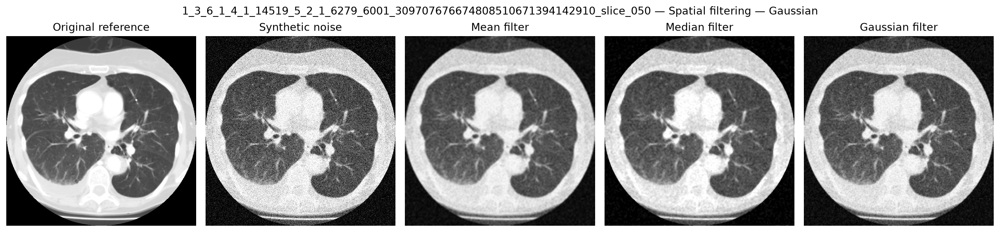
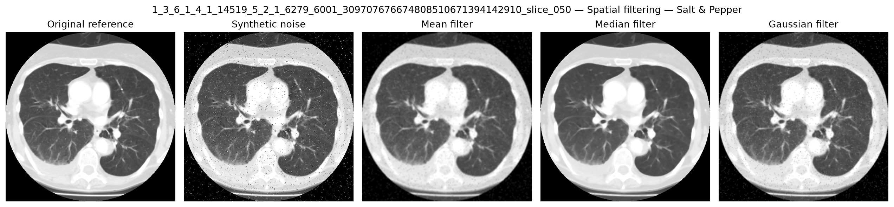
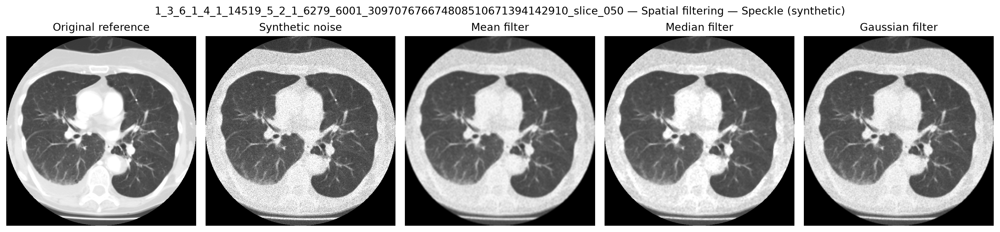
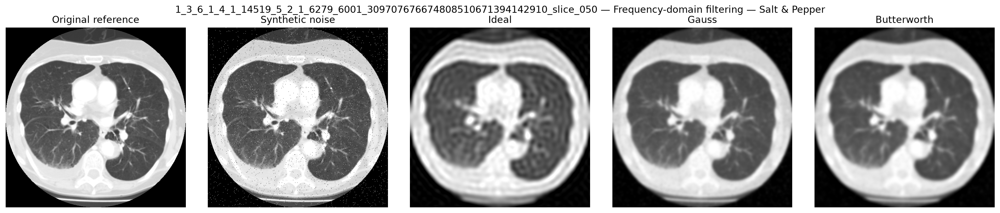
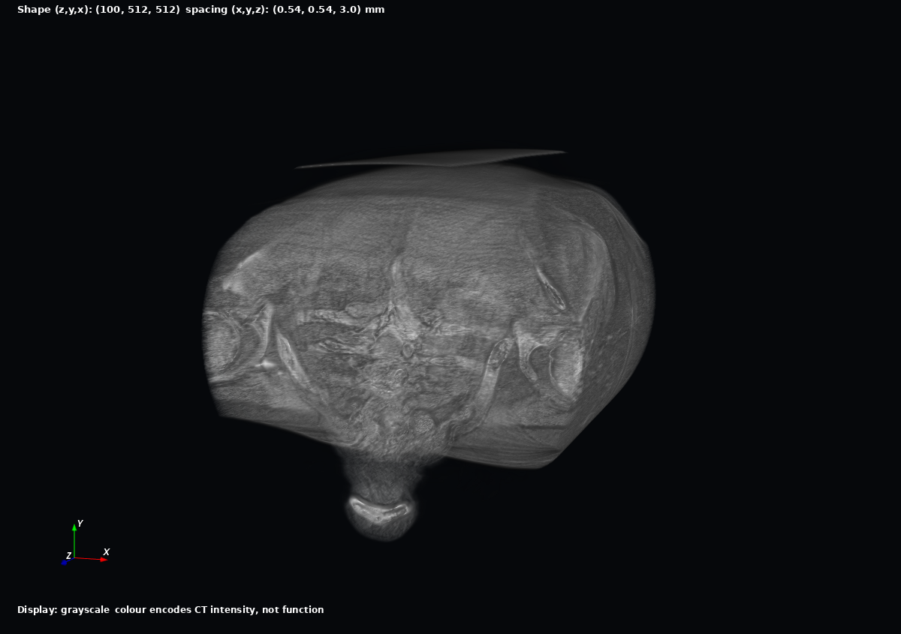
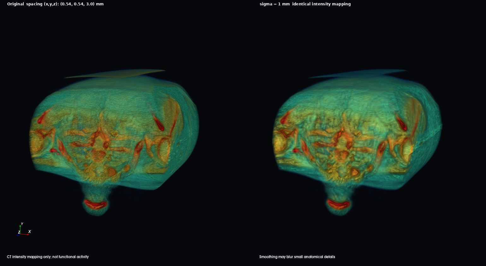

# Biomedical Image Denoising and Benchmarking

A biomedical image-processing project for **comparing classical denoising methods** on grayscale images and CT slices. It combines controlled synthetic-noise experiments, PSNR/SSIM measurements, a Streamlit application, a React dashboard with a FastAPI backend, and optional 3D DICOM CT visualization.

> **Scope:** educational and experimental image processing only. This project is not a diagnostic system and has not been clinically validated.


## What the project does

The project compares the output of several classical filters under controlled conditions. For the quantitative 2D experiments, a source image is kept as the reference, synthetic noise is added, and the filtered outputs are compared with that pre-noise reference.

- **Spatial filters:** mean, median, and Gaussian.
- **Frequency-domain filters:** ideal, Gaussian, and Butterworth low-pass filters using a 2D Fourier transform.
- **Synthetic noise models:** Gaussian, salt-and-pepper, and synthetic speckle.
- **Metrics:** peak signal-to-noise ratio (PSNR) and structural similarity index (SSIM).
- **Medical image handling:** grayscale images and DICOM CT slices, including modality rescaling and display windowing.
- **Optional 3D workflow:** validation and visualization of a consistent multi-slice DICOM CT series, with Gaussian smoothing specified in millimetres.

The project does **not** claim that one filter is best for every image or noise type. A higher PSNR or SSIM is a measure of similarity to the selected reference, not proof of improved diagnostic quality.

## Interfaces

### Streamlit application

Run the main application with `streamlit run app.py`. It includes a project overview, 2D denoising lab, 3D CT volume viewer, results/reports section, and a project guide.

### React dashboard and FastAPI

The `frontend/` directory contains a React + Vite interface. `api.py` provides the FastAPI endpoints used by the dashboard. The existing Render configuration is in `render.yaml`.

The deployed URLs and service names are deployment settings; changing the GitHub repository name does not automatically rename Render services. Check the live deployment separately before describing it as operational.

## How the comparison works

1. Load a grayscale image or a supported DICOM image/series.
2. For a controlled 2D experiment, add reproducible synthetic noise to the reference image.
3. Apply spatial and frequency-domain filters to the same noisy input.
4. Compare each result against the **same pre-noise reference** using PSNR and SSIM.
5. Inspect visual comparisons and summary tables, then interpret both metrics and visible detail.

For an uploaded image without a clean ground-truth counterpart, PSNR/SSIM cannot establish objective restoration accuracy. If no synthetic noise is added, similarity to the input is not evidence that the image has been denoised.

## Methods at a glance

| Method | Main characteristic | Trade-off to inspect |
| --- | --- | --- |
| Mean | Local averaging | Can blur edges and fine structures |
| Median | Non-linear neighbourhood filter | Often useful for impulse noise; effect depends on the image |
| Gaussian (spatial) | Weighted local smoothing | Reduces high-frequency variation but may blur detail |
| Ideal low-pass | Sharp frequency cutoff | Can introduce ringing around edges |
| Gaussian low-pass | Smooth frequency attenuation | Cutoff affects the balance between smoothing and detail |
| Butterworth low-pass | Adjustable frequency roll-off | Behaviour depends on cutoff and filter order |

## Repository structure

```text
.
├── app.py                         # Streamlit interface
├── api.py                         # FastAPI endpoints for the React dashboard
├── filters.py                     # 2D image loading, noise, filters, and metrics
├── evaluate_denoising.py          # Reproducible 2D CT benchmark
├── download_data.py               # Local synthetic examples and optional downloads
├── frontend/                      # React + Vite dashboard
├── src/
│   ├── dicom_volume.py             # DICOM series validation and volume loading
│   ├── volume_denoising.py         # 3D Gaussian smoothing
│   └── ...                         # Additional visualization and evaluation modules
├── tests and test_*.py             # Automated tests
├── docs/images/                    # Selected figures for documentation
├── docs/results/                   # Validation notes and historical result snapshots
├── requirements.txt
├── requirements-api.txt
├── render.yaml
└── .github/workflows/pytest.yml    # CI test workflow
```

## Setup

The commands below are intended to be run from the repository root. Python 3.10 or 3.12 is covered by the configured GitHub Actions matrix; other environments may work but are not covered by that workflow.

### 1. Create an environment and install dependencies

**Windows (Anaconda Prompt or Command Prompt):**

```bat
python -m venv .venv
.venv\Scripts\activate
python -m pip install --upgrade pip
python -m pip install -r requirements.txt
```

**macOS/Linux:**

```bash
python3 -m venv .venv
source .venv/bin/activate
python -m pip install --upgrade pip
python -m pip install -r requirements.txt
```

### 2. Generate local examples and launch Streamlit

```bash
python download_data.py --skip-kaggle --skip-dicom-test-files
streamlit run app.py
```

The example-generation command avoids the optional Kaggle and pydicom-fixture downloads. Optional external downloads have separate terms and are not required to run the basic interface.

### 3. Run the React dashboard locally

Keep the FastAPI process running in one terminal:

```bash
python -m uvicorn api:app --reload --host 127.0.0.1 --port 8000
```

In a second terminal:

```bash
cd frontend
npm install
npm run dev
```

The Vite development configuration proxies local `/api` requests to the FastAPI service. The hosted API has a `/api/health` endpoint. Live deployment availability has to be checked independently.

## Reproduce the 2D CT benchmark

The benchmark uses a **local DICOM CT series**; the larger series is not bundled in this repository. Place an authorized, single-series dataset locally, then pass the path to that series directory:

```bash
python evaluate_denoising.py --dicom-series "path/to/one_dicom_series" --repeats 3 --seed 42
```

The script selects up to five spread-out slices by default and creates local outputs under `reports/`, including per-run metrics, a summary CSV, and comparison figures. Generated reports are ignored by Git.

Current benchmark configuration in `evaluate_denoising.py` includes a frequency cutoff ratio of `0.15`. The committed files `docs/results/denoising_benchmark.csv` and `docs/results/denoising_summary.csv` are **historical snapshots from the earlier `0.10` cutoff configuration**. They must not be presented as results from the current default. Regenerate the benchmark against the intended local series before publishing updated numerical claims.

A controlled synthetic test of a separate fixture is documented in [frequency cutoff validation](docs/results/frequency_cutoff_validation.md). It is a small parameter check, not evidence that `0.15` is optimal for all CT images.

## Optional 3D CT workflow

The 3D tools require a consistent multi-slice DICOM series with usable geometry metadata. Example commands from the repository root:

```bash
python -m src.slice_viewer "path/to/one_dicom_series"
python run_3d_viewer.py "path/to/one_dicom_series" --output reports/3D/original_ct_volume.png
python run_denoised_3d_viewer.py "path/to/one_dicom_series" --sigma-mm 1.0 --output reports/3D/original_vs_smoothed_ct.png
python -m src.evaluate_volume_denoising "path/to/one_dicom_series" --sigma-mm 1.0
```

The loader checks series identity, slice orientation, image dimensions, and slice spacing. Volume smoothing may remove small structures; a smoother appearance alone does not establish better diagnostic quality. The 3D workflow is a visualization and image-processing experiment, not a clinical viewer.

## Tests

Run the test suite from the repository root:

```bash
python -m pytest -q
```

The GitHub Actions workflow is configured to run pytest on pushes and pull requests targeting `main`, using Python 3.10 and 3.12. The existence of a workflow does not by itself confirm that the latest commit passed; check the current Actions status on GitHub.

## Data and privacy

- The CT series used for benchmark development is local and is not included in this repository.
- The LIDC-IDRI collection is hosted by [The Cancer Imaging Archive (TCIA)](https://www.cancerimagingarchive.net/collection/lidc-idri/). Follow the collection's data-use and attribution requirements. Reference: Armato SG III et al., *Data From LIDC-IDRI*, DOI: [10.7937/K9/TCIA.2015.LO9QL9SX](https://doi.org/10.7937/K9/TCIA.2015.LO9QL9SX).
- `download_data.py` can generate a fictional synthetic DICOM example locally and optionally download third-party examples. Review the terms of any external dataset before use or redistribution.
- Use only images you are authorized to process. Do not upload identifiable patient data to a public deployment. DICOM files and exported HTML reports can contain sensitive metadata or image content.

## Limitations

- The quantitative 2D benchmark adds synthetic noise to a source slice and uses that same pre-noise slice as the reference. It does not provide a clean ground truth for real clinical noise.
- The documented CT benchmark is based on one local series and does not establish generalization across patients, scanners, protocols, or modalities.
- Synthetic speckle is included as a mathematical noise model; it is not presented as a CT-specific noise model.
- PSNR and SSIM do not measure clinical usefulness, preservation of every anatomical structure, or diagnostic performance.
- The filters are classical image-processing methods, not a trained AI model.
- A repository-wide software license has not been declared. Do not assume the code is licensed for reuse; select and add an appropriate license before inviting redistribution.

## Selected figures

The following figures are committed examples from earlier experiments. Check their associated parameters and validation notes before treating them as results for the current default configuration.

### Spatial filtering







### Frequency-domain filtering



### 3D visualization





See the [3D viewer validation report](docs/results/3d_viewer_validation.md) for the recorded data source and interpretation limits.
