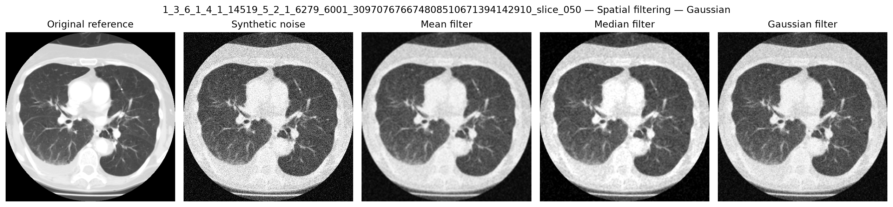
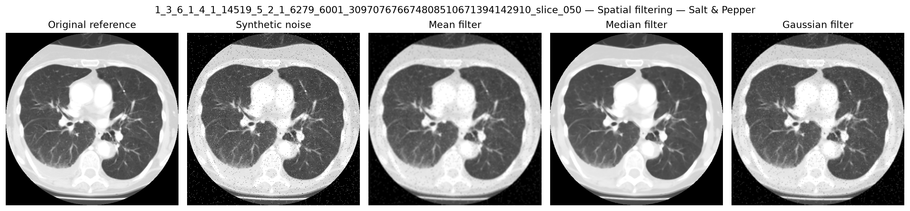
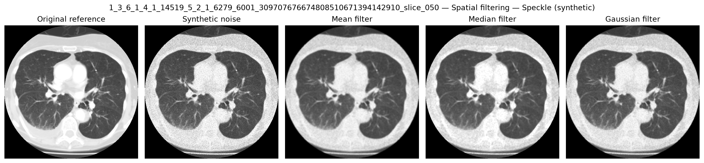
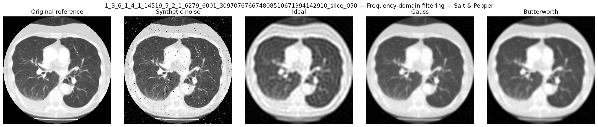
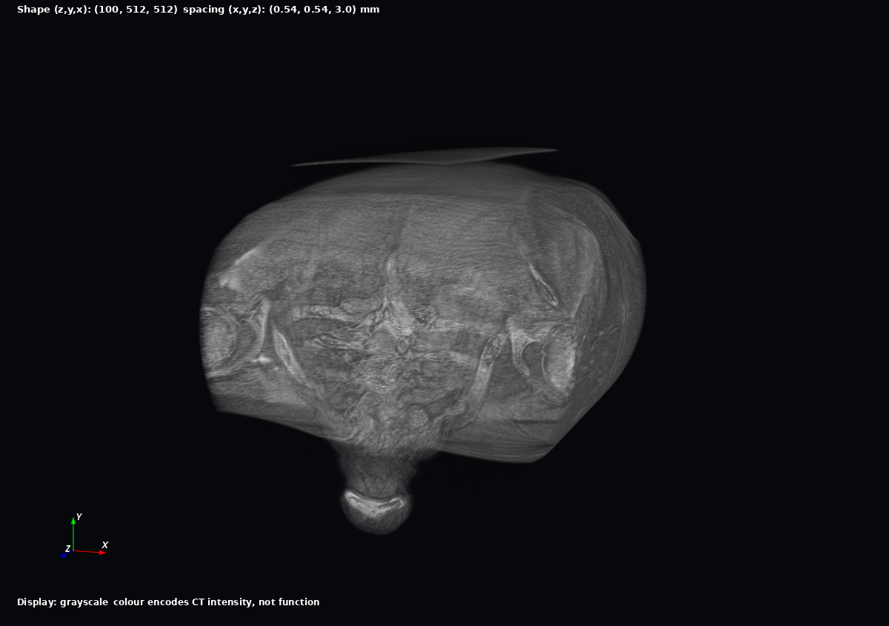
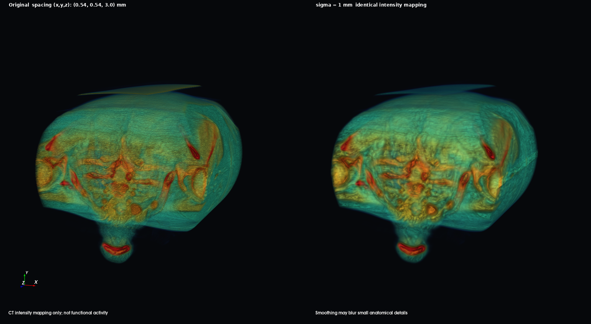

# Biomedical Image Denoising and Benchmarking

A biomedical image-processing project for **comparing classical denoising methods** on grayscale images and CT slices. It combines controlled synthetic-noise experiments, a tuned and held-out CT benchmark, a React dashboard backed by a FastAPI service that runs the real denoising code, a Streamlit application, and optional 3D DICOM CT visualization.

> **Scope:** educational and experimental image processing only. This project is not a diagnostic system and has not been clinically validated.


## At a glance

| What | Status (2026-10-25, one Windows laptop; nothing has run on GitHub Actions or Render) |
| --- | --- |
| Denoising methods | Nine classical, non-learned methods: mean, median, Gaussian, FFT ideal / Gaussian / Butterworth low-pass, **bilateral, non-local means and wavelet (BayesShrink)**. No neural network, on purpose ([why](backend/docs/methods_and_decisions.md)). |
| Benchmark | Synthetic noise in Hounsfield units on one public CT series; parameters tuned on 3 slices, results on 8 other slices; two evaluation masks; bootstrap intervals. **Exploratory: one patient, noisy reference, not an independent validation.** |
| Reproducibility | The recorded run was produced from a clean commit with source-file hashes and the input manifest recorded. A second full run from a clean clone gave byte-identical result files, and the six original filters reproduce an earlier recorded run byte for byte. |
| Dashboard | React + FastAPI. The 2D lab runs the real pipeline on an upload or a bundled sample and reports parameters used, scores and measured runtimes; the Benchmark V2 page reads recorded results and says when none are configured. |
| Tests | Backend 739 passed / 1 skipped (Python 3.12 and 3.10); API-only environment (Python 3.11, as installed on the host) 672 passed / 1 skipped; frontend 56 unit/component tests; 12 browser tests against the real API (1 skipped without a configured run). Lint clean (ruff, ESLint); no known vulnerabilities in the Python (pip-audit) or npm dependencies. |
| Deployment | `render.yaml` is configured and checked against the code; **it has not been deployed**, so there is no public URL. |

## What the project does

The project compares the output of several classical filters under controlled conditions. For the quantitative experiments, a source image is kept as the reference, synthetic noise is added, and the filtered outputs are compared with that pre-noise reference.

- **Spatial filters:** mean, median, and Gaussian.
- **Frequency-domain filters:** ideal, Gaussian, and Butterworth low-pass filters using a 2D Fourier transform.
- **Edge-preserving and multi-resolution filters:** bilateral, non-local means, and shift-averaged wavelet shrinkage with BayesShrink thresholds.
- **Synthetic noise models:** Gaussian, salt-and-pepper, and synthetic speckle (in the lab); white and correlated noise in Hounsfield units plus two robustness tests (in Benchmark V2).
- **Metrics:** PSNR, SSIM, and, in Benchmark V2, RMSE and MAE in Hounsfield units.
- **Medical image handling:** grayscale images and DICOM CT slices, including modality rescaling and display windowing.
- **Optional 3D workflow:** validation and visualization of a consistent multi-slice DICOM CT series, with Gaussian smoothing specified in millimetres.

The project does **not** claim that one filter is best for every image or noise type. A higher PSNR or SSIM is a measure of similarity to the selected reference, not proof of improved diagnostic quality, and none of the metrics measures whether small structures are preserved.

## Quick start (dashboard)

Requirements: Python 3.10 to 3.12 and Node.js 22.12 or newer. The dashboard is **two programs that both have to run**: the **API** (FastAPI, `http://127.0.0.1:8000`) and the **dashboard server** (Vite, `http://127.0.0.1:5173`). The browser talks only to the dashboard server, which forwards every `/api/...` request to the API, so start the API first. The commands were run on Windows 11 in Command Prompt (`cmd.exe`) and are the same in an Anaconda Prompt. Replace `D:\myprojects\biomedical-image-denoising-suite` by the folder you cloned into.

### Option A: one command (Windows)

```bat
cd /d D:\myprojects\biomedical-image-denoising-suite
.\dev.cmd start
```

Type the `.\`. A bare `dev.cmd` is answered with *'dev.cmd' is not recognized* in PowerShell and in Command Prompts where Windows does not search the current folder (the `NoDefaultCurrentDirectoryInExePath` setting, which is on for the machine this was tested on).

`start` chooses the Python (the variable `DENOISING_PYTHON` if set, else `backend\.venv`, else the `python` of the active environment), checks that the API's packages import, opens the API in its own window, **waits until `/api/health` answers**, then opens the dashboard server in a second window, checks that the dashboard really forwards to the API, and opens the browser. The two windows stay open, so an error is never hidden; it takes about 15 seconds. Two more commands:

```bat
.\dev.cmd status
.\dev.cmd stop
```

`status` shows what listens on ports 8000 and 5173, which Python is used and whether `127.0.0.1` and `localhost` answer, and changes nothing. `stop` ends only this project's processes: a program that listens on port 8000 or 5173 **and** is `uvicorn api:app` or the Vite server, plus the windows the helper opened. Anything else on those ports is reported and left alone; `.\dev.cmd stop -DryRun` lists what would be stopped. `start` also takes `-NoBrowser`.

### Option B: two windows by hand

**0. Environment (once).** Command Prompt with a virtual environment:

```bat
cd /d D:\myprojects\biomedical-image-denoising-suite\backend
python -m venv .venv
.venv\Scripts\activate
python -m pip install --upgrade pip
python -m pip install -r requirements-api.txt
```

Anaconda Prompt with an existing environment: `conda activate biomedical-denoising` (or `conda activate D:\path\to\environment`), then `cd /d D:\myprojects\biomedical-image-denoising-suite\backend` and `python -m pip install -r requirements-api.txt`. That last line is safe to repeat; it adds what is missing. One package matters: without PyWavelets the API still starts, but the wavelet method is marked *unavailable* (with the reason) in the lab, in `/api/health` and in `/api/methods`, and the helper prints a warning. On macOS/Linux use `source .venv/bin/activate`.

**1. Window 1: the API.** Activate the environment, then:

```bat
cd /d D:\myprojects\biomedical-image-denoising-suite\backend
set BENCHMARK_RUN_DIRS=docs/results/benchmark_v2_methods_2026-10-25
python -m uvicorn api:app --host 127.0.0.1 --port 8000
```

It is ready when the window prints `Uvicorn running on http://127.0.0.1:8000`. Check it in a browser: http://127.0.0.1:8000/ answers with a short JSON note saying that this is the API and where the dashboard and the documentation are, http://127.0.0.1:8000/docs lists every route, http://127.0.0.1:8000/api/health answers `{"status":"ok",...}`. `requirements-api.txt` is enough for the dashboard; `requirements.txt` adds Streamlit, VTK, matplotlib and the test tools. `BENCHMARK_RUN_DIRS` exposes the recorded benchmark run that ships with the repository; without it the Benchmark V2 page reports that no run is configured. (macOS/Linux: `export BENCHMARK_RUN_DIRS=docs/results/benchmark_v2_methods_2026-10-25`.)

**2. Window 2: the dashboard server.**

```bat
cd /d D:\myprojects\biomedical-image-denoising-suite\frontend
npm ci
npm run dev
```

It is ready when the window prints `Local: http://127.0.0.1:5173/`. If port 5173 is taken it stops with an error instead of choosing another port, so the address stays the one in this document.

**3. Open the dashboard:** http://127.0.0.1:5173/ (http://localhost:5173/ works as well; both were tested). The bottom of the sidebar must say **API ONLINE** with the API's address. If it does not, see the next section.

**4. Stop:** press `Ctrl+C` in each window (answer `Y` if asked), or run `.\dev.cmd stop` from the repository root.

If the API is started later than the dashboard, or is stopped and started again, the open page notices within a few seconds and loads its data by itself; nothing has to be reloaded. A stopped dashboard server needs a restart and a reload of the page.

### If the dashboard shows an error

| What you see | What it means | What to do |
| --- | --- | --- |
| **The API is not reachable** — *The dashboard server is running but cannot reach the API at http://127.0.0.1:8000 (ECONNREFUSED)* | The dashboard server is up; nothing answers on port 8000 (the API was not started, is still starting, stopped, or crashed). | Start the API (step 1, or `.\dev.cmd start`). Read the API window for an error. The page reconnects by itself every 2 seconds. |
| **The dashboard server is not responding** — *The dashboard server at http://localhost:5173 is not responding* | The page is an old tab; the Vite server behind it was closed or stopped, so no request can leave the browser. | Start it again (step 2, or `.\dev.cmd start`), then reload the page. |
| *… answered /api/… with HTTP 404, but not as the API* | Something other than the dashboard server answers on the page's address (a static host, another program on the port), or a production build was made without `VITE_API_BASE_URL`. | Open the page through `npm run dev` or `npm run preview`; for a separately hosted build, set `VITE_API_BASE_URL` when building (and `CORS_ORIGINS` on the API). |
| *Cannot reach the API at … check VITE_API_BASE_URL and the API's CORS_ORIGINS* | A build that calls a fixed API address cannot reach it. | Start the API at that address, or rebuild with the right `VITE_API_BASE_URL`. |
| A method is greyed out as *unavailable* | An optional package (PyWavelets) is missing in the Python that runs the API. | `python -m pip install -r requirements-api.txt` in that environment, then restart the API. |
| `http://127.0.0.1:8000/` shows JSON, not the dashboard | That is the API. The dashboard is on port 5173. | Open http://127.0.0.1:5173/. |
| `Errno 10048` / *port already in use* | Another program (often an earlier run) holds port 8000 or 5173. | `.\dev.cmd status` shows who; `.\dev.cmd stop` ends this project's own processes. |
| *'dev.cmd' is not recognized* | See Option A: the current folder is not searched. | Use `.\dev.cmd`, and run it from the repository root. |

`.\dev.cmd status` answers most of these in one screen. To see what the browser sends, open the developer tools (F12), tab *Network*, and filter by `api`: every request goes to the page's own address (port 5173) and is forwarded to port 8000. Details of the proxy and of the error messages are in [frontend/README.md](frontend/README.md).

### Using the lab

Open the **2D Denoising Lab**: choose *Cell in saline* or *Brain MRI slice* from the sample list (or upload a PNG, JPEG or DICOM slice), tick the methods to compare, press *Run denoising*, and use the divider to compare the outputs. The table shows the scores the API computed for that run, the parameters actually used and each method's measured runtime. Interface details are in [frontend/README.md](frontend/README.md).

## Interfaces

### React dashboard and FastAPI

`frontend/` is a React + Vite interface; `backend/api.py` provides the FastAPI service and `backend/api_v2.py` serves recorded benchmark runs. Pages: Overview (scope, limits, live API and benchmark status), 2D Denoising Lab, Benchmark V2, 3D CT Explorer, Older 2D results, Methods & Guide. Every number on a page comes from the API (a computation done for that request, or a recorded file labelled with its provenance); there are no built-in demo values. The dashboard shows when the API is offline and offers a retry.

The Streamlit application (`streamlit run app.py` from `backend/`) is the earlier exploratory 2D/3D lab; the React dashboard is the main interface and the only one that shows the tuned benchmark.

### API

| Endpoint | Purpose |
| --- | --- |
| `GET /api/health` | Liveness check |
| `GET /api/methods` | The nine methods with parameter limits, defaults, assumptions and references, plus the server's size and concurrency limits |
| `GET /api/samples`, `GET /api/samples/{id}/file` | Bundled sample images with provenance, licence and cautions (ids only; no client path is ever opened) |
| `POST /api/image/preview` | Decode an upload and return its size and a PNG preview |
| `POST /api/denoise` | Add noise, run the selected methods, return images, PSNR/SSIM, the parameters used and per-method runtimes |
| `POST /api/ct/volume` | Reconstruct an interactive volume from the slices of one DICOM series |
| `GET /api/results` | The older 2D benchmark file, with a provenance label |
| `GET /api/v2/runs`, `/runs/{id}`, `/runs/{id}/tables/{name}`, `/runs/{id}/interpretation`, `/runs/{id}/slice-comparison`, `/runs/{id}/slice-image` | Recorded benchmark V2 runs: provenance and integrity, tables, computed statements, images recomputed from the recorded seeds |

Example (from the repository root, API running):

```bash
curl -X POST http://127.0.0.1:8000/api/denoise \
  -F "file=@backend/samples/brain_mri.png" -F noise_type=Gaussian -F seed=7 -F methods=mean,nlm
```

The reply contains `images` (PNG data URLs), `results` (PSNR and SSIM per output), `methods` (the parameters actually used), `settings` (noise and seed) and `timings_ms`. Errors are plain text in `detail` with a meaningful status: 422 for an invalid parameter, method or image, 413 when an upload or an image is over its limit (25 MB and 4 MP by default; 1 MP for the slower methods), 400 for an unreadable file, 503 with `Retry-After` when every processing slot is busy. Messages never contain server paths. Limits are set with `MAX_UPLOAD_MB`, `MAX_IMAGE_PIXELS`, `MAX_ADVANCED_PIXELS`, `MAX_CONCURRENT_JOBS`, `MAX_CT_FILES` and `MAX_CT_TOTAL_MB`. The API has no authentication or rate limiting and should not be exposed to the open internet without them.

## How the comparison works

1. Load a grayscale image or a supported DICOM image/series.
2. For a controlled experiment, add reproducible synthetic noise to the reference image.
3. Apply the selected methods to the same noisy input.
4. Compare each result against the **same pre-noise reference**.
5. Inspect visual comparisons and summary tables, then interpret both metrics and visible detail.

For an uploaded image without a clean ground-truth counterpart, PSNR/SSIM cannot establish objective restoration accuracy: a real scan is never noise-free, so the reference is itself noisy. If no synthetic noise is added, similarity to the input is not evidence that the image has been denoised. In the lab, DICOM intensities are mapped to [0, 1] with the file's window (or min–max), so lab scores are on a display scale, not in Hounsfield units.

## Methods at a glance

| Method | Main characteristic | Trade-off to inspect |
| --- | --- | --- |
| Mean | Local averaging | Can blur edges and fine structures |
| Median | Non-linear neighbourhood filter | Often useful for impulse noise; effect depends on the image |
| Gaussian (spatial) | Weighted local smoothing | Reduces high-frequency variation but may blur detail |
| Ideal low-pass | Sharp frequency cutoff | Can introduce ringing around edges |
| Gaussian low-pass | Smooth frequency attenuation | Cutoff affects the balance between smoothing and detail |
| Butterworth low-pass | Adjustable frequency roll-off | Behaviour depends on cutoff and filter order |
| Bilateral | Averages pixels close in space and similar in intensity | Keeps strong edges, but noise sitting on an edge stays |
| Non-local means | Averages pixels whose surrounding patches look alike | Assumes repeating structure and independent noise; too strong a setting erases texture |
| Wavelet (BayesShrink) | Soft-thresholds wavelet coefficients, averaged over shifts | Assumes white Gaussian noise; correlated and impulse noise are poorly handled |

Definitions, assumptions, implementations and the parameter-selection rules are in [methods_and_decisions.md](backend/docs/methods_and_decisions.md).

## Repository structure

```text
.
├── backend/                        # Python code, tests, documentation assets (run commands from here)
│   ├── api.py                      # FastAPI service: lab, samples, CT volume, limits
│   ├── api_v2.py                   # Read-only /api/v2 endpoints over recorded benchmark runs
│   ├── methods.py                  # Registry of the nine lab methods (parameters, limits, assumptions)
│   ├── sample_images.py            # Catalogue of the bundled samples with provenance
│   ├── filters.py                  # Image loading, noise, filters (including bilateral, NLM, wavelet), metrics
│   ├── benchmark_v2.py             # Benchmark V2 (HU-domain noise, tuning/test split, two masks)
│   ├── evaluate_denoising.py       # Earlier 2D CT benchmark
│   ├── provenance.py               # Provenance label for result files
│   ├── app.py                      # Streamlit interface
│   ├── download_data.py            # Local synthetic examples and optional downloads
│   ├── src/                        # DICOM volume loading, 3D smoothing, viewers
│   ├── test_*.py                   # pytest suite
│   ├── samples/                    # Small example images and a synthetic DICOM file
│   ├── docs/methods_and_decisions.md  # Methods, metrics, protocol, decision on deep learning, references
│   ├── docs/results/               # Historical snapshots + the shipped recorded benchmark run (byte-exact)
│   ├── requirements.txt            # Full development / Streamlit / test dependencies
│   ├── requirements-api.txt        # Runtime dependencies of the hosted API
│   └── ruff.toml                   # Lint configuration
├── frontend/                       # React + Vite dashboard (src/test: Vitest, e2e: Playwright)
├── render.yaml                     # Render deployment (not deployed)
├── .gitattributes                  # Keeps recorded runs byte-exact
└── .github/workflows/              # Python tests + lint, frontend lint/test/build, browser tests
```

Local datasets (`backend/data/`) and generated outputs (`backend/reports/`, `backend/outputs/`) are ignored by Git.

## Setup for development

Unless stated otherwise, Python commands are run from `backend/`. Python 3.10, 3.11 (API-only) and 3.12 were exercised locally; the GitHub workflow is configured for 3.10 and 3.12 but has not run.

```bash
cd backend
python -m venv .venv                 # then activate it (see Quick start)
python -m pip install --upgrade pip
python -m pip install -r requirements.txt
python download_data.py --skip-kaggle --skip-dicom-test-files   # optional: regenerates the local examples
streamlit run app.py                 # optional: the Streamlit interface
```

The example-generation command avoids the optional Kaggle and pydicom-fixture downloads. Optional external downloads have separate terms and are not required.

## Exploratory benchmark V2

> **Status: exploratory, partly reproducible comparison study.** It compares nine classical denoisers under *synthetic* noise on a *single* CT series. It does not show that any filter is best in general, has no clinical validation, and is not an independent external validation.

### Question and workflow

When synthetic noise of a stated size is added to a CT slice, how closely do filtered results return to the original slice, and how much does that depend on the method, its setting, the image region and the metric?

1. Load one DICOM series and convert it to Hounsfield units (HU) with the modality rescale.
2. Fix two evaluation masks per slice from the original slice, before any noise exists.
3. Add synthetic noise in HU for 8 noise conditions, with reproducible seeds.
4. **Tuning:** for each noise condition and method, choose one setting on 3 tuning slices (RMSE_HU on the principal mask only).
5. **Test:** apply that frozen setting to 8 other slices (5 noise realisations each); report means with bootstrap intervals over slices.
6. Compare the methods with each other and with the unfiltered noisy image.

### Data and reference

- One local series labelled `LIDC-IDRI-0709` in its DICOM headers (100 slices, 512 × 512, 0.54 × 0.54 mm, 3.0 mm slice spacing, convolution kernel `FC01`); its folder carries the LIDC-IDRI licence text (CC BY 3.0). **Whether the local files are identical to the public TCIA release has not been verified.** The run records the series UID and a SHA-256 manifest of its 101 files, so anyone can compare their copy. The data are not part of this repository. Citation: Armato SG III et al., *Data From LIDC-IDRI*, TCIA, DOI [10.7937/K9/TCIA.2015.LO9QL9SX](https://doi.org/10.7937/K9/TCIA.2015.LO9QL9SX) (resolves to the TCIA collection page); Clark K et al., *J Digit Imaging* 2013;26:1045.
- **The reference is not clean ground truth.** It is a real, already-reconstructed clinical slice with its own noise, and the synthetic noise is added to it. A rough white-noise-equivalent estimate of the reference's own high-frequency noise is about 3 HU (2.7 to 4.2 HU over the 11 slices), but CT noise is correlated, so that is a lower bound; estimates of the image's noise differ by an order of magnitude depending on the definition. Errors measure the difference from this slice, not accuracy against the true anatomy.

### Methods, noise, masks, metrics

Nine methods (see above). Eight noise conditions, all added in HU: white Gaussian noise (10, 25, 50 HU), "correlated" noise (white noise smoothed by a 1-pixel Gaussian and renormalised; **an unvalidated construction**), and two robustness tests that are *not* CT noise models (2 % salt-and-pepper, multiplicative speckle). Noise levels are scenarios, not measurements of a scanner, and no source was found that would support calling them typical.

The *principal* mask is the largest body region above −500 HU. The *inner* mask removes everything within 10 px of the scanner padding; it is an experimental sensitivity choice, not clinically validated. Metrics: RMSE_HU and MAE_HU (HU, unclipped, over the mask); PSNR and SSIM on images displayed with a −600/1500 HU window (clipped to [0, 1]), SSIM averaged over windows fully inside the mask. Definitions and what each metric cannot show are in [methods_and_decisions.md](backend/docs/methods_and_decisions.md).

### What the recorded run shows (illustration, not a ranking)

The run `backend/docs/results/benchmark_v2_methods_2026-10-25` (grid `methods`; the six original filters plus bilateral, non-local means and wavelet BayesShrink). Mean test RMSE_HU over 8 slices with the 95 % bootstrap interval over slices, principal mask (lowest of the nine in bold):

| Condition | Unfiltered | Best of the six original filters | Bilateral | Non-local means | Wavelet BayesShrink |
|---|---|---|---|---|---|
| white 10 HU | 10.00 [9.99, 10.00] | 9.80 [9.78, 9.81] (FFT Gaussian) | 8.13 [8.01, 8.27] | 7.85 [7.64, 8.12] | **6.68 [6.45, 6.97]** |
| white 25 HU | 25.00 [24.99, 25.02] | 15.23 [14.82, 15.64] (Median) | 14.56 [13.98, 15.01] | 13.36 [12.94, 13.72] | **12.49 [11.98, 13.30]** |
| white 50 HU | 49.98 [49.96, 50.01] | 24.37 [23.98, 24.69] (Median) | 20.80 [19.78, 21.63] | **19.89 [18.93, 20.63]** | 20.99 [20.79, 21.20] |
| correlated 10 HU | 10.00 [10.00, 10.01] | 10.00 [9.99, 10.00] (Gaussian) | 9.46 [9.40, 9.54] | **9.35 [9.27, 9.45]** | 9.78 [9.73, 9.83] |
| correlated 25 HU | 25.02 [24.99, 25.05] | 22.50 [22.27, 22.74] (Median) | 20.02 [19.65, 20.31] | **18.31 [17.76, 18.75]** | 22.57 [22.48, 22.70] |
| correlated 50 HU | 49.89 [49.87, 49.92] | 36.78 [35.86, 37.51] (Median) | 34.39 [33.76, 34.89] | **29.71 [28.66, 30.48]** | 44.63 [44.17, 45.19] |
| salt-and-pepper 2 % (robustness) | 130.74 [127.82, 133.95] | **13.62 [13.22, 14.05]** (Median) | 45.68 [44.23, 47.43] | 46.82 [44.06, 49.37] | 56.28 [54.04, 59.04] |
| speckle (robustness) | 119.19 [110.77, 128.67] | 40.17 [38.99, 41.56] (Median) | **35.69 [34.66, 36.98]** | 39.04 [36.49, 41.75] | 44.68 [43.39, 46.47] |

Paired over the same 8 slices, the added filter minus the best of the six original filters (negative = lower error; "lower" or "higher" only when the whole interval is on one side of zero):

| Condition | Bilateral | Non-local means | Wavelet BayesShrink |
|---|---|---|---|
| white 10 HU | −1.67 [−1.80, −1.51] lower | −1.94 [−2.17, −1.67] lower | −3.11 [−3.35, −2.82] lower |
| white 25 HU | −0.67 [−0.94, −0.42] lower | −1.87 [−2.03, −1.71] lower | −2.74 [−3.18, −2.15] lower |
| white 50 HU | −3.57 [−4.25, −2.98] lower | −4.48 [−5.08, −3.99] lower | −3.38 [−3.63, −3.12] lower |
| correlated 10 HU | −0.53 [−0.59, −0.46] lower | −0.65 [−0.73, −0.54] lower | −0.22 [−0.26, −0.16] lower |
| correlated 25 HU | −2.49 [−2.66, −2.33] lower | −4.20 [−4.53, −3.93] lower | +0.07 [−0.10, +0.25] unresolved |
| correlated 50 HU | −2.39 [−2.72, −2.05] lower | −7.07 [−7.28, −6.85] lower | +7.85 [+7.16, +8.62] higher |
| salt-and-pepper 2 % | +32.06 [+30.87, +33.55] higher | +33.21 [+30.67, +35.41] higher | +42.66 [+40.47, +45.44] higher |
| speckle | −4.49 [−4.75, −4.22] lower | −1.13 [−3.39, +0.62] unresolved | +4.51 [+3.04, +6.21] higher |

**How to read this.**

- Over the 8 conditions the added filters had a lower RMSE_HU than the best original filter in 7 (bilateral), 6 (non-local means) and 4 (wavelet) of them, with an interval entirely below zero. The pattern follows what each method assumes: wavelet shrinkage, which models white Gaussian noise, is best on white noise at 10 and 25 HU and clearly worse on strongly correlated noise and on impulse noise; non-local means is lowest on correlated noise; bilateral is lowest on speckle; the median filter remains by far the best on salt-and-pepper noise.
- The lowest-RMSE method is the same on the principal and the inner mask in 7 of the 8 conditions; the exception is white 50 HU (non-local means on the principal mask, wavelet on the inner mask). Both masks are shown on the dashboard. At 50 HU the tuned 3 × 3 mean filter looks almost useless on the principal mask (49.98 → 48.40 HU) and strongly useful on the inner mask (49.98 → 21.00 HU), which is the boundary effect described below.
- RMSE_HU and PSNR name the same family in all 8 conditions; SSIM names a different one in 2 (white 50 HU and correlated 10 HU: bilateral instead of non-local means). The tuning minimum of each added method lies strictly inside its grid in 23 of the 24 (method, condition) cases; the exception is bilateral on salt-and-pepper noise, at the strongest end of the grid, where the filter has become a Gaussian filter.
- The tuned "assumed noise level" of the wavelet filter and the bilateral intensity scale are larger than the true noise (for example 50 HU assumed for 25 HU white noise): they are strength controls, not noise estimates.
- **None of this shows that the denoised images are better for any clinical purpose.** The error is measured against a noisy reference; smoothing more strongly can remove small structures, and no structure-preservation measure was computed.

**Why the mask matters.** A 3-pixel band along the mask edge is about 2.3 % of the mask pixels, yet after mean or Gaussian smoothing its RMSE_HU is 228–284 HU, and in a worked example it carried 87–89 % of the squared HU error. Tuning on RMSE_HU over the principal mask is therefore largely a criterion about the body boundary: where "no filter" scored best, that means no smoothing lowered the boundary-dominated error, not that smoothing is useless for the rest of the image. Tuning on the inner mask would change the choice in 34 of 48 cells of the earlier six-filter run (tuning slices only).

**RMSE_HU, PSNR and SSIM can prefer different settings.** In the earlier six-filter run PSNR chose the same setting as RMSE_HU in 44 of 48 cases on the tuning slices, SSIM in only 6 of 48.

### Earlier comparison: extended grid versus first grid

The first six-filter run used a smaller grid without a "no filter" option; the extended grid adds one. Comparing the tuned results of the two on the 8 test slices (48 cells, filtered versus filtered):

| Metric (extended − first) | Mask | Better | Worse | Unresolved |
|---|---|---|---|---|
| RMSE_HU | principal (the tuning criterion) | **30** | 0 | 18 (same setting selected) |
| RMSE_HU | inner | 12 | **18** | 18 (same setting selected) |
| MAE_HU | principal | 15 | 15 | 18 (same setting selected) |
| PSNR | principal | 29 | 0 | 19 (18 same setting, 1 unresolved) |
| SSIM (primary) | principal | 7 | **23** | 18 (same setting selected) |

"30 better, 0 worse" holds only for RMSE_HU on the principal mask, the criterion the grids were tuned for, and it reverses on the inner mask and for SSIM. For RMSE_HU on the principal mask, 34 of 48 filtered cells are materially below the unfiltered image and none above, but the absence of increases is partly built in: "no filter" is part of the grid.

### Limits of the evidence

- **One CT series, 3 tuning and 8 test slices.** No generalisation across patients, scanners, doses or kernels is claimed; slices of one scan are not independent.
- **Test slices are not untouched.** The code keeps test data out of the selection (a test perturbs the test slices only and finds identical selections), but the test slices were looked at in earlier runs, and the three added methods were chosen after those results were known. Their grids were fixed from the tuning slices before any test slice was scored with them, and the run was executed once, but this is not an independent validation.
- **Bootstrap intervals** use 8 slices of one patient. In simulation with 8 slices the nominal 95 % interval covered the true mean in about 79–89 % of cases, so intervals are somewhat too narrow; read them as descriptive spread. No correction for multiple comparisons was applied.
- **Fixed hyper-parameters.** Each method has one tuned strength; the others (bilateral spatial scale 1.5 px, non-local-means patch 5 and search distance 6, wavelet `sym4` with 3 levels) were fixed, not tuned, and the bilateral scale is a compromise between noise types. A differently configured method could rank differently.
- **Not comparable with the historical results** in `backend/docs/results/` (different noise, clipping before filtering, fixed settings, no split).
- **No small-structure, edge or texture measure** and no task-based (for example detectability) evaluation.

### Provenance and reproduction

The shipped run `benchmark_v2_methods_2026-10-25` was produced on 2026-10-25 from a **clean clone of commit `0b1380b048d0`**. Its `run_metadata.json` records the commit (no `+dirty`), package versions (Python 3.12.15, NumPy 2.5.4, SciPy 1.18.1, scikit-image 0.26.0, PyWavelets 1.10.0, OpenCV 5.0.0, pandas 3.1.0, pydicom 3.0.2), the SHA-256 of the source files that define the run (line-ending independent), the series UID and a SHA-256 manifest of the 101 input files, all parameters and grids, seeds, and the SHA-256 of every result file. What was checked:

- Two full runs from two different clean commits (`2fe94f6` and `0b1380b`) gave **byte-identical** result files (all 12 CSVs). The first run's metadata was superseded because it held non-standard JSON (`NaN`) that browsers cannot parse; that defect was fixed and covered by tests before the shipped run was made.
- For the six original filters and the unfiltered baseline, every result table is **byte-identical** to the run recorded on 2026-10-24 (which came from an uncommitted working tree, `d788e0c` plus local changes), so the extension changed nothing for them.
- The 101 input-file hashes equal the manifest recorded on 2026-10-24. This shows the same local files were used; it does not show they are identical to the TCIA release.
- The dashboard recomputes images from the recorded seeds and the recomputed RMSE_HU matched the stored rows for the ten outputs in each of the three conditions spot-checked (to better than 10⁻⁴ HU).

This demonstrates reproducibility on this machine and series; it does not validate the results on other data or platforms.

```bash
cd backend
python benchmark_v2.py --dicom-series "path/to/LIDC-IDRI-0709" --out "path/outside/repo/benchmark_v2_run" --plan-only
python benchmark_v2.py --dicom-series "path/to/LIDC-IDRI-0709" --out "path/outside/repo/benchmark_v2_run" --grid-version methods
```

Prerequisites not provided by this repository: a local copy of the LIDC-IDRI series (from TCIA, under its terms) and an output directory **outside** the repository (the script refuses to write inside it). `--grid-version expanded` (the default) and `v1` reproduce the six-filter runs. The command refuses a series that is not CT or has no modality rescale. The full `methods` run took about 24 minutes (1,430 s) on a 16-thread laptop while other work was running; the peak memory of the benchmark script itself was not measured.

### Dashboard (Benchmark V2 page)

The page shows run provenance and CSV integrity (SHA-256 against the recorded values), test metrics with intervals for both masks, change relative to the unfiltered image, tuned parameters (with a note on what each added method's tuned value means), cautious statements computed from the tables, and, when the server has the CT series (`CT_SERIES_DIR`), a slice viewer with window/level, noisy and filtered images or difference maps, mask outline, intensity profile and boundary-band versus deeper-region error. Slice images are recomputed from the recorded seed and the page states whether they reproduce the recorded rows. Nothing is displayed unless the API serves a real run. The server never accepts paths from the browser: runs are addressed by directory name, and only the configured series is read.

## Historical 2D benchmark (`evaluate_denoising.py`)

The benchmark uses a **local DICOM CT series**; the larger series is not bundled in this repository. Place an authorized, single-series dataset locally, then pass the path to that series directory:

```bash
python evaluate_denoising.py --dicom-series "path/to/one_dicom_series" --repeats 3 --seed 42
```

The script selects up to five spread-out slices by default and creates local outputs under `backend/reports/` (when run from `backend/`), including per-run metrics, a summary CSV, and comparison figures. Generated reports are ignored by Git.

Current benchmark configuration in `evaluate_denoising.py` includes a frequency cutoff ratio of `0.15`. The committed files `backend/docs/results/denoising_benchmark.csv` and `backend/docs/results/denoising_summary.csv` are **historical snapshots from the earlier `0.10` cutoff configuration**. They must not be presented as results from the current default. A controlled synthetic test of a separate fixture is documented in [frequency cutoff validation](backend/docs/results/frequency_cutoff_validation.md); it is a small parameter check, not evidence that `0.15` is optimal for all CT images.

## Optional 3D CT workflow

The 3D tools require a consistent multi-slice DICOM series with usable geometry metadata. Example commands, run from `backend/`:

```bash
python -m src.slice_viewer "path/to/one_dicom_series"
python run_3d_viewer.py "path/to/one_dicom_series" --output reports/3D/original_ct_volume.png
python run_denoised_3d_viewer.py "path/to/one_dicom_series" --sigma-mm 1.0 --output reports/3D/original_vs_smoothed_ct.png
python -m src.evaluate_volume_denoising "path/to/one_dicom_series" --sigma-mm 1.0
```

The loader checks series identity, slice orientation, image dimensions, and slice spacing, and reads slices one at a time. Volume smoothing may remove small structures; a smoother appearance alone does not establish better diagnostic quality. The 3D workflow is a visualization and image-processing experiment, not a clinical viewer.

## Tests and checks

| Check | Command | Last result (2026-10-25) |
| --- | --- | --- |
| Backend, Python 3.12.15 (NumPy 2.5.4) | `cd backend && python -m pytest -q` | 739 passed, 1 skipped, 43 s |
| Backend, Python 3.10.21 (NumPy 2.2.6, pandas 2.3.3, scikit-image 0.25.2) | same | 739 passed, 1 skipped, 45 s |
| Hosted-API environment, Python 3.11.16, `requirements-api.txt` only | pytest on the 13 API-related test files | 672 passed, 1 skipped, 42 s |
| Python lint | `cd backend && ruff check .` | All checks passed |
| Frontend lint | `cd frontend && npm run lint` | No problems (`--max-warnings 0`) |
| Frontend unit and component tests | `npm test` | 56 passed |
| Browser tests (real Chrome, real API) incl. axe-core in both themes | `npm run e2e` | 12 passed, 1 skipped (the skipped one needs `E2E_BENCHMARK_RUN_DIR`; with it set, that test runs and passes and the "no run configured" test is skipped) |
| Production build | `npm run build` | Succeeds; entry chunk 222 kB (Plotly, 4.7 MB, loads on demand) |
| Dependency vulnerabilities | `pip-audit`; `npm audit` | None known (Python environment of the full requirements; npm 0 findings) |

The one skipped backend test is an optional comparison with an external metadata file (`BENCHMARK_V2_INITIAL_RUN_METADATA`). The frontend tests mock the API with fixtures generated from the real backend, and a backend test fails if those fixtures drift. The GitHub Actions workflows run the same checks on pushes and pull requests to `main`; **they have not been executed on GitHub**, so the existence of a workflow does not confirm that the latest commit passed there.

## Deployment (Render)

`render.yaml` defines a Python web service for the API (`rootDir: backend`) and a static site for the dashboard (`npm ci && npm run build` on Node 22). It sets limits for a 512 MB instance from measured peak memory (importing the API takes about 170 MB; a 512 × 512 image through all nine methods peaks near 235 MB, 1024 × 1024 near 415 MB, a 2048 × 2048 image with the six classical methods near 1 GB; the 3D explorer adds about 4 MB per slice) and serves the shipped benchmark run. A test checks the file against the variables the API reads and the files it names.

**Status: not deployed. No URL exists and nothing has been tested on Render.** The measurements were made on Windows, not on Render. To publish:

1. Review and decide on what to publish (the branch is local; nothing has been pushed). Add a software licence first, if the code is to be reusable.
2. Push the branch (or merge it into `main`) to GitHub, then confirm the workflows pass.
3. In the Render dashboard choose *New → Blueprint* and select the repository. It creates both services from `render.yaml`.
4. After the first deploy, check that the two `*.onrender.com` hostnames match the ones written in `render.yaml` (`CORS_ORIGINS` on the API, `VITE_API_BASE_URL` on the site); Render appends a suffix if a name is taken. Fix them and redeploy if they differ.
5. Verify the public URLs: `GET <api>/api/health`, open the dashboard, run the lab on a sample, open Benchmark V2 (it should report 12 verified files; images need the CT series and are not available on the hosted site).

The free plan sleeps when idle, so the first request after a pause is slow. The 3D explorer accepts at most 60 slices there.

## Data and privacy

- The CT series used for benchmark development is local and is not included in this repository; only derived results are (aggregated metrics, no pixel data and no patient identifiers).
- The LIDC-IDRI collection is hosted by [The Cancer Imaging Archive (TCIA)](https://www.cancerimagingarchive.net/collection/lidc-idri/) under CC BY 3.0. Follow the collection's data-use and attribution requirements.
- Bundled samples: `synthetic_ct_scan.dcm` is a fictional slice generated by `download_data.py`; `cells_tissue.png` is a quantitative phase image of a cell in saline (scikit-image's `data.cell()`, CC0 per its documentation; it is not tissue); `brain_mri.png` is a slice of scikit-image's `data.brain()` (University of North Carolina volume-rendering test data), **whose original terms could not be verified**.
- `download_data.py` can generate a fictional synthetic DICOM example locally and optionally download third-party examples. Review the terms of any external dataset before use or redistribution.
- Use only images you are authorized to process. A locally run API keeps files on your computer; a hosted one receives them. Do not upload identifiable patient data to a public deployment (the dashboard states which case applies). DICOM files and exported HTML reports can contain sensitive metadata or image content.

## Limitations

- The quantitative experiments add synthetic noise to a source slice and use that same slice as the reference. They do not provide a clean ground truth for real clinical noise, and the scores say nothing about diagnostic value or preserved small structures.
- The documented CT benchmark is based on one local series of one patient and does not establish generalization across patients, scanners, protocols, or modalities. The identity of the local series with the public LIDC-IDRI release has not been verified.
- Benchmark V2 results are exploratory: noisy clinical reference, synthetic noise of unvalidated realism, few slices of one patient, test slices that were inspected during development, and intervals that under-cover (see the V2 section).
- No learned denoising model is included, because the available data (one patient, no clean reference) cannot support an honest training and validation protocol; see [methods_and_decisions.md](backend/docs/methods_and_decisions.md). BM3D was considered and not implemented.
- Synthetic speckle is included as a mathematical noise model; it is not presented as a CT-specific noise model. MRI magnitude noise is Rician, not Gaussian, so the Gaussian noise added to the MRI sample is a teaching device.
- The filters are classical image-processing methods, not a trained AI model.
- The API has no authentication, and its limits are sized for a small instance; the hosted memory behaviour is untested.
- **A repository-wide software license has not been declared.** Do not assume the code is licensed for reuse; the owner must choose and add one before inviting redistribution.

## Selected figures

The following figures are committed examples from earlier experiments. Check their associated parameters and validation notes before treating them as results for the current default configuration.

### Spatial filtering







### Frequency-domain filtering



### 3D visualization





See the [3D viewer validation report](backend/docs/results/3d_viewer_validation.md) for the recorded data source and interpretation limits.

## References

Bibliographic records were checked against Crossref and PubMed on 2026-10-25; full texts were not read. The complete list, with DOIs, is in [methods_and_decisions.md](backend/docs/methods_and_decisions.md#6-references). Key sources: Tomasi and Manduchi 1998 (bilateral); Buades, Coll and Morel 2005 (non-local means); Donoho and Johnstone 1994, Chang, Yu and Vetterli 2000 and Coifman and Donoho 1995 (wavelet shrinkage, BayesShrink, shift averaging); Wang et al. 2004 (SSIM); Armato et al. 2011 and the TCIA data citation (LIDC-IDRI); Eulig et al. 2024 (fair benchmarking of low-dose CT denoisers).
