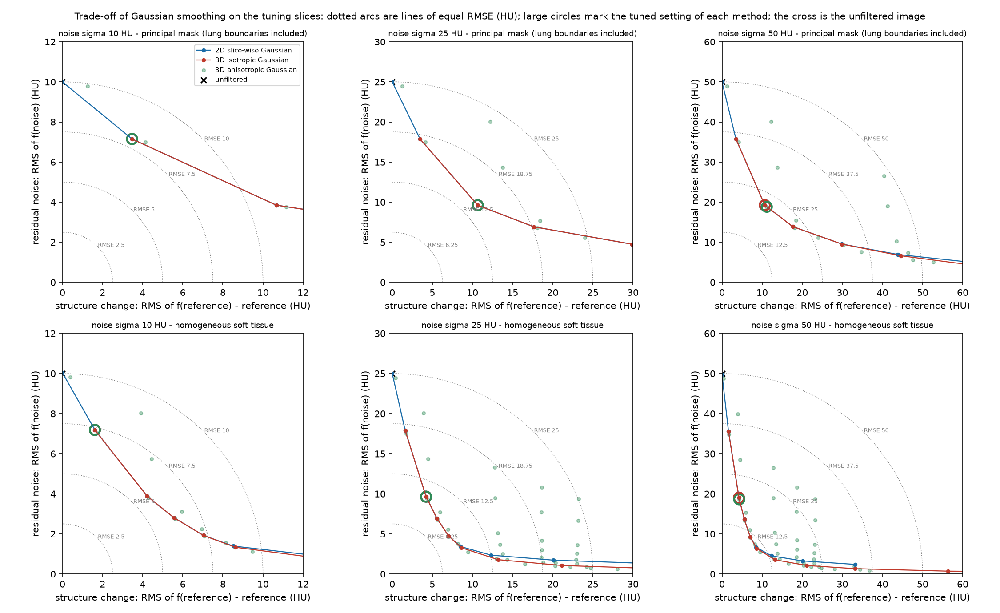
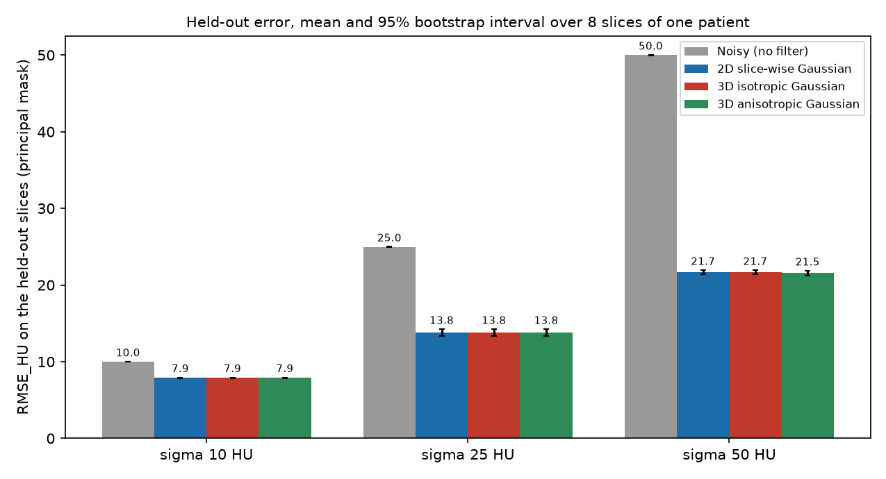
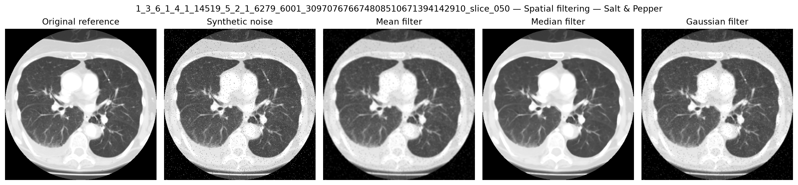
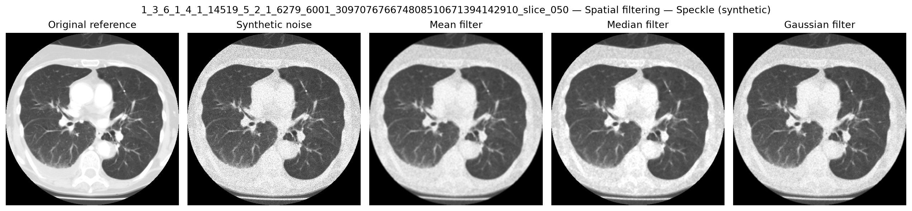

# Biomedical Image Denoising and Benchmarking

A biomedical image-processing project for **comparing classical denoising methods** on grayscale images and CT slices. It combines controlled synthetic-noise experiments, a tuned and held-out CT benchmark, a React dashboard backed by a FastAPI service that runs the real denoising code, a Streamlit application, and optional 3D DICOM CT visualization.

> **Scope:** educational and experimental image processing only. This project is not a diagnostic system and has not been clinically validated.


## At a glance

| What | Status (2026-10-29, one Windows laptop; the workflows of this branch have not run on GitHub yet, although earlier versions ran on `main`; nothing has run on Render) |
| --- | --- |
| Denoising methods | Nine classical, non-learned methods: mean, median, Gaussian, FFT ideal / Gaussian / Butterworth low-pass, **bilateral, non-local means and wavelet (BayesShrink)**. No neural network, on purpose ([why](backend/docs/methods_and_decisions.md)). |
| Benchmarks | **V2 (2D):** synthetic noise in Hounsfield units on one public CT series, parameters tuned on 3 slices and tested on 8 others, two masks, bootstrap intervals. **3D:** slice-wise versus volumetric Gaussian smoothing, same protocol, with the error split into structure change and residual noise; run twice, with noise independent between slices and with noise correlated between adjacent slices as measured on the series. A legacy fixed-setting benchmark is kept apart. **All exploratory: one patient, noisy reference, not an independent validation.** |
| Reproducibility | **V2:** the recorded run was produced from a clean commit with source-file hashes and the input manifest recorded; two full runs from two commits gave byte-identical result files and the six original filters reproduce an earlier recorded run. On 2026-10-27 the **complete benchmark was run again with the current code and gave 12 result files byte-identical to the recorded run** (three source files had changed since the recorded run; their new hashes are the only difference in the metadata; [details](backend/docs/benchmark_v2.md#provenance-and-reproduction)). **3D:** two complete executions of the first run gave identical tables and 72 recorded rows were recomputed independently; both runs were made from uncommitted code, so their `git_commit` reads `+dirty` and the source hashes identify the code. |
| Dashboard | React + FastAPI. The 2D lab runs the real pipeline on an upload or a bundled sample and reports parameters used, scores and measured runtimes. The Benchmark V2 and Benchmark 3D pages read recorded runs, check their files against the SHA-256 hashes recorded in each run's metadata (and list any file the metadata does not cover), and say when no run is configured. |
| Tests | Backend 915 passed / 1 skipped (Python 3.12 and 3.10); API-only environment (Python 3.11, the 25 test files other than `test_vtk_viewer.py` and `test_benchmark_3d.py`) 876 passed / 1 skipped; frontend 95 unit/component tests (5 of them start the real Vite server); 25 browser tests against the real API and real servers (1 skipped when a benchmark run is configured). Lint clean (ruff, ESLint); no known vulnerabilities in the Python (pip-audit) or npm dependencies on 2026-10-29. |
| Deployment | `render.yaml` is configured and checked against the code; **it has not been deployed**, so there is no public URL. |

## What the project does

The project compares the output of several classical filters under controlled conditions. For the quantitative experiments, a source image is kept as the reference, synthetic noise is added, and the filtered outputs are compared with that pre-noise reference.

- **Spatial filters:** mean, median, and Gaussian.
- **Frequency-domain filters:** ideal, Gaussian, and Butterworth low-pass filters using a 2D Fourier transform.
- **Edge-preserving and multi-resolution filters:** bilateral, non-local means, and shift-averaged wavelet shrinkage with BayesShrink thresholds.
- **Synthetic noise models:** Gaussian, salt-and-pepper, and synthetic speckle (in the lab); white and correlated noise in Hounsfield units plus two robustness tests (in Benchmark V2).
- **Metrics:** PSNR, SSIM, and, in Benchmark V2, RMSE and MAE in Hounsfield units.
- **Medical image handling:** grayscale images and DICOM CT slices, including modality rescaling and display windowing.
- **3D handling:** loading of a consistent multi-slice DICOM series with physical geometry, orthogonal views and volume rendering, a Gaussian smoothing script with its width in millimetres, and **Benchmark 3D**, which tests whether smoothing across slices helps (it barely does on 3 mm slices; see [Benchmarks](#benchmarks)).

The project does **not** claim that one filter is best for every image or noise type. A higher PSNR or SSIM is a measure of similarity to the selected reference, not proof of improved diagnostic quality, and none of the metrics measures whether small structures are preserved.

## Quick start (dashboard)

Requirements: **Python 3.10 to 3.12** and **Node.js 22.12 or newer** (with npm). The commands work on Windows, macOS and Linux; where a command differs by shell it is shown for each. The measurements reported in this README were made on Windows 11 only.

The dashboard is **two programs that both have to run**: the **API** (FastAPI, `http://127.0.0.1:8000`) and the **dashboard server** (Vite, `http://127.0.0.1:5173`). The browser talks only to the dashboard server, which forwards every `/api/...` request to the API, so start the API first.

### 1. Install (once)

```bash
git clone https://github.com/ghada-59/biomedical-image-denoising-suite.git
cd biomedical-image-denoising-suite
```

**Backend.** Create a virtual environment and install the API's runtime requirements:

```bash
cd backend
python -m venv .venv
```

Activate the environment (in every new terminal that runs backend commands):

| Shell | Command |
| --- | --- |
| Windows Command Prompt | `.venv\Scripts\activate` |
| Windows PowerShell | `.venv\Scripts\Activate.ps1` |
| macOS / Linux | `source .venv/bin/activate` |

```bash
python -m pip install --upgrade pip
python -m pip install -r requirements-api.txt
```

`requirements-api.txt` is all the dashboard needs. For the test suite, the Streamlit app and the 3D tools install `requirements.txt` instead; it contains the API's packages plus pytest, Streamlit, VTK and matplotlib. Any other Python environment (for example a Conda environment) works the same way: activate it and run the `pip install` line. If PyWavelets is missing the API still starts, but the wavelet method is marked *unavailable* (with the reason) in the lab, in `/api/health` and in `/api/methods`.

**Frontend.**

```bash
cd frontend
npm ci
```

`npm ci` installs exactly the versions in `package-lock.json`.

### 2. Run the dashboard (two terminals, API first)

**Terminal 1: the API**, from `backend/` with the environment activated:

```bash
cd backend
python -m uvicorn api:app --host 127.0.0.1 --port 8000
```

It is ready when it prints `Uvicorn running on http://127.0.0.1:8000`. Check it in a browser: http://127.0.0.1:8000/ answers with a short JSON note saying that this is the API, http://127.0.0.1:8000/docs lists every route, and http://127.0.0.1:8000/api/health answers `{"status":"ok",...}`.

To make the recorded benchmark runs that ship with the repository visible on the *Benchmark V2* and *Benchmark 3D* pages, set `BENCHMARK_RUN_DIRS` (one V2 run) and `BENCHMARK_3D_RUN_DIRS` (two 3D runs, separated by `;` on Windows and `:` elsewhere) before starting the API. Without them those pages say that no run is configured:

| Shell | Command |
| --- | --- |
| Windows Command Prompt | `set BENCHMARK_RUN_DIRS=docs/results/benchmark_v2_methods_2026-10-25` and `set BENCHMARK_3D_RUN_DIRS=docs/results/benchmark_3d_2026-10-26;docs/results/benchmark_3d_correlated_2026-10-27` |
| Windows PowerShell | `$env:BENCHMARK_RUN_DIRS = "docs/results/benchmark_v2_methods_2026-10-25"` and `$env:BENCHMARK_3D_RUN_DIRS = "docs/results/benchmark_3d_2026-10-26;docs/results/benchmark_3d_correlated_2026-10-27"` |
| macOS / Linux | `export BENCHMARK_RUN_DIRS=docs/results/benchmark_v2_methods_2026-10-25` and `export BENCHMARK_3D_RUN_DIRS=docs/results/benchmark_3d_2026-10-26:docs/results/benchmark_3d_correlated_2026-10-27` |

**Terminal 2: the dashboard server**, from `frontend/`:

```bash
cd frontend
npm run dev
```

It is ready when it prints `Local: http://127.0.0.1:5173/`. If port 5173 is taken it stops with an error instead of choosing another port, so the address stays the one in this document.

**Open the dashboard:** http://127.0.0.1:5173/ (http://localhost:5173/ works as well). The bottom of the sidebar must say **API ONLINE** with the page's address. If it does not, see [If the dashboard shows an error](#if-the-dashboard-shows-an-error).

**Stop** each program with `Ctrl+C` in its terminal. A program started this way ends when its terminal is closed.

If the API is started later than the dashboard, or is stopped and started again, the open page notices within a few seconds and loads its data by itself; nothing has to be reloaded. A stopped dashboard server needs a restart and a reload of the page.

### Optional: Windows launcher (`dev.cmd`)

`dev.cmd` is a convenience for Windows only; nothing depends on it, and the two commands above are the standard way to run the project. From the repository root, in Command Prompt or PowerShell (type the `.\`; a bare `dev.cmd` is "not recognized" in PowerShell and wherever Windows does not search the current folder):

```bat
.\dev.cmd start
.\dev.cmd status
.\dev.cmd stop
```

`start` chooses the Python (the variable `DENOISING_PYTHON` if set, else `backend\.venv`, else the `python` on the `PATH`), checks that the API's packages import, starts the API, **waits until `/api/health` answers**, then starts the dashboard server, checks that the dashboard really forwards to the API, and opens the browser (`-NoBrowser` skips that); it takes about 15 seconds. Both services run in the background **without a console window**, so closing the terminal that ran `start` does not stop them. Their output goes to `logs\dev\api.log` and `logs\dev\dashboard.log` (ignored by Git; the previous run's logs are kept as `*.previous.log`), and when a start fails the last lines of the log are printed.

`status` shows what listens on ports 8000 and 5173, which Python is used, whether PyWavelets is installed, and whether `127.0.0.1` and `localhost` answer for both services; it changes nothing. `stop` ends only this project's processes: a program that listens on port 8000 or 5173 **and** is `uvicorn api:app` or the Vite server, plus the launcher processes directly above it (npm, the venv's `python.exe`, the shell that redirects the log). Anything else on those ports, and the services of another clone of the project, is reported and left alone; `.\dev.cmd stop -DryRun` lists what would be stopped. Background services keep running until `stop`, a sign-out or a restart. The helper is `scripts/dev.ps1`; it runs on the Windows PowerShell 5.1 that ships with Windows (no other version was tested).

### Configuration

Everything is configured with environment variables; none is required for a local run. [`backend/.env.example`](backend/.env.example) and [`frontend/.env.example`](frontend/.env.example) list them with their defaults and placeholder values only (the project has no secrets); a test keeps them identical to the variables the code reads. The API does not read a `.env` file by itself: start it with `python -m uvicorn api:app --env-file .env` from `backend/` (`python-dotenv` comes with `uvicorn[standard]`), or set the variables in the shell. In the dashboard, only `VITE_API_BASE_URL` can live in a `.env` file; `VITE_DEV_API_TARGET` must be set in the shell that starts the server.

| Variable | Read by | Default | Purpose |
| --- | --- | --- | --- |
| `BENCHMARK_RUN_DIRS` | API | none | Benchmark V2 run directories to serve (a relative entry means relative to `backend/`, whatever the working directory; several are separated by `;` on Windows and `:` elsewhere). Only directories that hold a `run_metadata.json` are served. |
| `BENCHMARK_3D_RUN_DIRS` | API | none | Benchmark 3D run directories to serve; same rules as `BENCHMARK_RUN_DIRS`. |
| `CT_SERIES_DIR` | API | none | A local CT series; lets the Benchmark V2 page recompute images. Its path is never sent to, or accepted from, the browser. |
| `CORS_ORIGINS` | API | the two development origins (`127.0.0.1:5173`, `localhost:5173`) | Extra browser origins allowed to call the API, comma-separated. Needed only when the page and the API have different origins (a hosted dashboard). |
| `MAX_UPLOAD_MB`, `MAX_IMAGE_PIXELS`, `MAX_ADVANCED_PIXELS`, `MAX_CONCURRENT_JOBS`, `MAX_CT_FILES`, `MAX_CT_TOTAL_MB` | API | 25, 4,194,304, 1,048,576, 2, 400, 200 | Request limits (see the API section). |
| `VITE_DEV_API_TARGET` | dashboard server (`npm run dev`, `npm run preview`) | `http://127.0.0.1:8000` | Where `/api` is forwarded. |
| `VITE_API_BASE_URL` | dashboard **build** (`npm run build`) | unset: the page calls its own origin | The API's address, baked into a production build served by something that does not forward `/api`. |
| `E2E_PYTHON`, `E2E_BROWSER_CHANNEL`, `E2E_BENCHMARK_RUN_DIR` | browser tests | `python`, `chrome`, unset | Python for the API, browser (`chrome`, `msedge`, `chromium`), optional run directory (see [Tests and checks](#tests-and-checks)). |
| `DENOISING_PYTHON` | `dev.cmd` only | see above | Python used by the Windows helper. |

The ports (8000 for the API, 5173 for the dashboard) and the use of `127.0.0.1` instead of `localhost` are development defaults, not requirements: `localhost` also works in the browser, and every address can be changed with the commands' `--host` / `--port` options and the variables above. `127.0.0.1` is used on purpose, because `localhost` resolves to `::1` first on some machines while the documented servers listen on IPv4.

### If the dashboard shows an error

| What you see | What it means | What to do |
| --- | --- | --- |
| **The API is not reachable** — *The dashboard server is running but cannot reach the API at http://127.0.0.1:8000 (ECONNREFUSED)* | The dashboard server is up; nothing answers on port 8000 (the API was not started, is still starting, stopped, or crashed). | Start the API (terminal 1 above). Read its terminal for an error. The page reconnects by itself every 2 seconds. |
| **The dashboard server is not responding** — *The dashboard server at http://localhost:5173 is not responding* | The page is an old tab; the Vite server behind it stopped, so no request can leave the browser. The usual cause is closing the terminal that was running `npm run dev`. | Start it again (terminal 2 above), then reload the page. |
| *… answered /api/… with HTTP 404, but not as the API* | Something other than the dashboard server answers on the page's address (a static host, another program on the port), or a production build was made without `VITE_API_BASE_URL`. | Open the page through `npm run dev` or `npm run preview`; for a separately hosted build, set `VITE_API_BASE_URL` when building (and `CORS_ORIGINS` on the API). |
| *Cannot reach the API at … check VITE_API_BASE_URL and the API's CORS_ORIGINS* | A build that calls a fixed API address cannot reach it. | Start the API at that address, or rebuild with the right `VITE_API_BASE_URL`. |
| A method is greyed out as *unavailable* | An optional package (PyWavelets) is missing in the Python that runs the API. | `python -m pip install -r requirements-api.txt` in that environment, then restart the API. |
| `http://127.0.0.1:8000/` shows JSON, not the dashboard | That is the API. The dashboard is on port 5173. | Open http://127.0.0.1:5173/. |
| `Errno 10048` / `Address already in use` | Another program (often an earlier run) holds port 8000 or 5173. | Stop it, or start on another port. On Windows `.\dev.cmd status` shows who holds the ports and `.\dev.cmd stop` ends this project's own processes. |
| *'dev.cmd' is not recognized* | Windows does not search the current folder for commands. | Use `.\dev.cmd` from the repository root. |

To see what the browser sends, open the developer tools (F12), tab *Network*, and filter by `api`: every request goes to the page's own address (port 5173) and is forwarded to port 8000. Details of the proxy and of the error messages are in [frontend/README.md](frontend/README.md).

### Using the lab

Open the **2D Denoising Lab**: choose *Cell in saline* or *Chest CT slice (LIDC-IDRI)* from the sample list (or upload a PNG, JPEG or DICOM slice), tick the methods to compare, press *Run denoising*, and use the divider to compare the outputs. The table shows the scores the API computed for that run, the parameters actually used and each method's measured runtime. Interface details are in [frontend/README.md](frontend/README.md).

### Production build

```bash
cd frontend
npm run build          # writes frontend/dist/
npm run preview        # serves dist/ on http://127.0.0.1:4173 and forwards /api like the development server
```

`dist/` is a static site. It calls `/api/...` on its own origin unless it was built with `VITE_API_BASE_URL`. There are two ways to deploy it, and both were exercised by the browser tests with the real API (`frontend/e2e/production.spec.js`):

- **Different origins** (what `render.yaml` does): build with `VITE_API_BASE_URL=https://your-api.example` and start the API with `CORS_ORIGINS=https://your-dashboard.example`.
- **Same origin**: build without `VITE_API_BASE_URL` and serve `dist/` from a web server that also forwards `/api/` to the API (`vite preview` does exactly that, for local checks only; it is not a production web server, and no other web server was tested).

A static host that serves `index.html` for every path and has no API behind it is detected: the page shows *The API is not reachable* instead of looking healthy.

The API in production: `uvicorn api:app --host 0.0.0.0 --port $PORT` from `backend/` with `requirements-api.txt` installed, as in `render.yaml`. It has no authentication or rate limiting; see [Deployment](#deployment-render).

## Interfaces

### React dashboard and FastAPI

`frontend/` is a React + Vite interface; `backend/api.py` provides the FastAPI service, and `backend/api_v2.py` and `backend/api_3d.py` serve recorded benchmark runs. Pages: Overview (scope, limits, live API and benchmark status), 2D Denoising Lab, 3D CT Explorer, Benchmark V2, Benchmark 3D, Older 2D results, Methods & Guide. Benchmark 3D shows the two recorded runs side by side: provenance and file integrity, held-out results by method with intervals, the trade-off between structure change and residual noise, the selected parameters, statements computed from the tables, and the recorded figures. Every number on a page comes from the API (a computation done for that request, or a recorded file labelled with its provenance); there are no built-in demo values. The dashboard shows when the API is offline and offers a retry.

The Streamlit application (`streamlit run app.py` from `backend/`) is the earlier exploratory 2D/3D lab; the React dashboard is the main interface and the only one that shows the tuned benchmark.

### API

| Endpoint | Purpose |
| --- | --- |
| `GET /api/health` | Liveness check |
| `GET /api/methods` | The nine methods with parameter limits, defaults, assumptions and references, plus the server's size and concurrency limits |
| `GET /api/samples`, `GET /api/samples/{id}/file` | Bundled sample images with provenance, licence and cautions (ids only; no client path is ever opened). Ids: `synthetic_ct`, `chest_ct`, `cell_phase`; the retired ids `brain_mri` and `head_ct` answer 404 |
| `GET /api/3d/runs`, `GET /api/3d/runs/{run_id}`, `GET /api/3d/runs/{run_id}/tables/{name}`, `GET /api/3d/runs/{run_id}/figures/{name}`, `GET /api/3d/runs/{run_id}/interpretation` | Recorded Benchmark 3D runs (read-only, set with `BENCHMARK_3D_RUN_DIRS`): provenance and file integrity, tables, the recorded figures, and statements computed from the tables |
| `POST /api/image/preview` | Decode an upload and return its size and a PNG preview |
| `POST /api/denoise` | Add noise, run the selected methods, return images, PSNR/SSIM, the parameters used and per-method runtimes |
| `POST /api/ct/volume` | Reconstruct an interactive volume from the slices of one DICOM series |
| `GET /api/results` | The older 2D benchmark file, with a provenance label |
| `GET /api/v2/runs`, `/runs/{id}`, `/runs/{id}/tables/{name}`, `/runs/{id}/interpretation`, `/runs/{id}/slice-comparison`, `/runs/{id}/slice-image` | Recorded benchmark V2 runs: provenance and integrity, tables, computed statements, images recomputed from the recorded seeds |

Example (from the repository root, API running):

```bash
curl -X POST http://127.0.0.1:8000/api/denoise \
  -F "file=@backend/samples/chest_ct.png" -F noise_type=Gaussian -F seed=7 -F methods=mean,nlm
```

The reply contains `images` (PNG data URLs), `results` (PSNR and SSIM per output), `methods` (the parameters actually used), `settings` (noise and seed) and `timings_ms`. Errors are plain text in `detail` with a meaningful status: 422 for an invalid parameter, method or image, 413 when an upload or an image is over its limit (25 MB and 4 MP by default; 1 MP for the slower methods), 400 for an unreadable file, 503 with `Retry-After` when every processing slot is busy. Messages never contain server paths. Limits are set with `MAX_UPLOAD_MB`, `MAX_IMAGE_PIXELS`, `MAX_ADVANCED_PIXELS`, `MAX_CONCURRENT_JOBS`, `MAX_CT_FILES` and `MAX_CT_TOTAL_MB`. The API has no authentication or rate limiting and should not be exposed to the open internet without them.

## How the comparison works

1. Load a grayscale image or a supported DICOM image/series.
2. For a controlled experiment, add reproducible synthetic noise to the reference image.
3. Apply the selected methods to the same noisy input.
4. Compare each result against the **same pre-noise reference**.
5. Inspect visual comparisons and summary tables, then interpret both metrics and visible detail.

For an uploaded image without a clean ground-truth counterpart, PSNR/SSIM cannot establish objective restoration accuracy: a real scan is never noise-free, so the reference is itself noisy. If no synthetic noise is added, similarity to the input is not evidence that the image has been denoised. In the lab, DICOM intensities are mapped to [0, 1] with the file's window (or min–max), so lab scores are on a display scale, not in Hounsfield units.

## Methods at a glance

| Method | Main characteristic | Trade-off to inspect |
| --- | --- | --- |
| Mean | Local averaging | Can blur edges and fine structures |
| Median | Non-linear neighbourhood filter | Often useful for impulse noise; effect depends on the image |
| Gaussian (spatial) | Weighted local smoothing | Reduces high-frequency variation but may blur detail |
| Ideal low-pass | Sharp frequency cutoff | Can introduce ringing around edges |
| Gaussian low-pass | Smooth frequency attenuation | Cutoff affects the balance between smoothing and detail |
| Butterworth low-pass | Adjustable frequency roll-off | Behaviour depends on cutoff and filter order |
| Bilateral | Averages pixels close in space and similar in intensity | Keeps strong edges, but noise sitting on an edge stays |
| Non-local means | Averages pixels whose surrounding patches look alike | Assumes repeating structure and independent noise; too strong a setting erases texture |
| Wavelet (BayesShrink) | Soft-thresholds wavelet coefficients, averaged over shifts | Assumes white Gaussian noise; correlated and impulse noise are poorly handled |

Definitions, assumptions, implementations and the parameter-selection rules are in [methods_and_decisions.md](backend/docs/methods_and_decisions.md).

## Repository structure

```text
.
├── backend/                        # Python code, tests, documentation assets (run commands from here)
│   ├── api.py                      # FastAPI service: lab, samples, CT volume, limits
│   ├── api_v2.py                   # Read-only /api/v2 endpoints over recorded benchmark runs
│   ├── api_3d.py                   # Read-only /api/3d endpoints over recorded Benchmark 3D runs
│   ├── methods.py                  # Registry of the nine lab methods (parameters, limits, assumptions)
│   ├── sample_images.py            # Catalogue of the bundled samples with provenance
│   ├── filters.py                  # Image loading, noise, filters (including bilateral, NLM, wavelet), metrics
│   ├── benchmark_v2.py             # Benchmark V2 (HU-domain noise, tuning/test split, two masks)
│   ├── benchmark_3d.py             # Benchmark 3D (slice-wise vs volumetric Gaussian smoothing)
│   ├── benchmark_3d_correlated.py  # The same benchmark with noise correlated between adjacent slices (calls benchmark_3d.py unchanged)
│   ├── evaluate_denoising.py       # Earlier 2D CT benchmark
│   ├── provenance.py               # Provenance label for result files
│   ├── diagnostics.py              # Measurements that qualify the benchmarks' assumptions (real noise correlation, edge-band error, bootstrap coverage)
│   ├── app.py                      # Streamlit interface
│   ├── download_data.py            # Local synthetic examples and optional downloads
│   ├── src/                        # DICOM volume loading, oriented orthogonal views, 3D smoothing, viewers
│   ├── test_*.py                   # pytest suite
│   ├── samples/                    # Small example images and a synthetic DICOM file (README.md: provenance of each)
│   ├── docs/methods_and_decisions.md  # Methods, metrics, protocol, decision on deep learning, references
│   ├── docs/references_verification.md  # What was checked, and what was not, for each cited reference
│   ├── docs/benchmark_v2.md        # Complete description of Benchmark V2
│   ├── docs/benchmark_3d.md        # Complete description of Benchmark 3D (both runs)
│   ├── docs/images/                # Committed figures (README.md: how each was made and checked)
│   ├── docs/results/               # Historical snapshots + the recorded V2 run and the two 3D runs (byte-exact)
│   ├── CONTRIBUTING.md             # Development setup, checks, how to add a method or a benchmark run
│   ├── requirements.txt            # Full development / Streamlit / test dependencies
│   ├── requirements-api.txt        # Runtime dependencies of the hosted API
│   └── ruff.toml                   # Lint configuration
├── frontend/                       # React + Vite dashboard (src/test: Vitest, e2e: Playwright)
├── dev.cmd, scripts/dev.ps1        # Optional Windows launcher (start / status / stop); not needed to run the project
├── scripts/smoke_test.py           # Checks a running API (and a deployed dashboard) from outside; standard library only
├── render.yaml                     # Render deployment (not deployed)
├── .gitattributes                  # Keeps recorded runs byte-exact
└── .github/workflows/              # Python tests + lint, frontend lint/test/build, browser tests
```

Local datasets (`backend/data/`), generated outputs (`backend/reports/`, `backend/outputs/`), the launcher's `logs/`, virtual environments, `node_modules/` and build output are ignored by Git; the recorded benchmark runs under `backend/docs/results/` are tracked on purpose.

## Development

Python 3.10, 3.11 (API-only) and 3.12 were exercised; the workflow in this branch is configured for 3.10 and 3.12 but has not run yet (an earlier version ran on `main`). Install the full development environment once (from `backend/`, with a virtual environment activated as in the quick start):

```bash
cd backend
python -m pip install -r requirements.txt            # API + Streamlit + VTK + pytest + httpx
python -m pip install "ruff==0.17.2"                 # the linter version CI uses
cd ../frontend && npm ci
```

Everyday commands:

| Task | Command (from) |
| --- | --- |
| Run the API with reload | `python -m uvicorn api:app --reload --host 127.0.0.1 --port 8000` (`backend/`) |
| Run the dashboard server | `npm run dev` (`frontend/`) |
| Backend tests | `python -m pytest -q` (`backend/`) |
| Python lint | `ruff check --config ruff.toml . ../scripts` (`backend/`) |
| Frontend lint / unit tests | `npm run lint` / `npm test` (`frontend/`) |
| Browser tests (real API, real servers, installed Chrome) | `E2E_PYTHON=<python with the API requirements> npm run e2e` (`frontend/`; in PowerShell `$env:E2E_PYTHON = "..."` first) |
| Production build | `npm run build` (`frontend/`) |
| Streamlit app (optional) | `streamlit run app.py` (`backend/`) |
| Regenerate the local examples (optional) | `python download_data.py --skip-kaggle --skip-dicom-test-files` (`backend/`) |

The example-generation command avoids the optional Kaggle and pydicom-fixture downloads. Optional external downloads have separate terms and are not required. How to add a method or a benchmark run, and what the checks cover, is in [backend/CONTRIBUTING.md](backend/CONTRIBUTING.md).

## Benchmarks

Three experiments are kept apart on purpose. The API and the dashboard serve Benchmark V2 only; the other two are command-line scripts with recorded results.

| | **Benchmark V2** (primary, 2D) | **Benchmark 3D** (new) | **Historical 2D benchmark** (legacy) |
| --- | --- | --- | --- |
| Question | How close does each of nine classical filters bring a noisy CT slice back to the original slice, when every filter is tuned? | Does smoothing across neighbouring slices help, compared with smoothing slice by slice? | Fixed-setting comparison of six filters on windowed slices: the first experiment of the project |
| Noise | White and 1-pixel-correlated noise of 10, 25, 50 HU; 2 % impulse; multiplicative speckle (all defined in HU) | White noise of 10, 25, 50 HU, independent for every voxel | Gaussian (variance 0.02 on the display scale), salt-and-pepper, synthetic speckle |
| Settings | Tuned per condition on 3 slices, tested on 8 other slices | Tuned per condition on 3 slices, tested on 8 other slices at least 8 slices away | One fixed setting per filter, no tuning |
| Measures | RMSE and MAE in HU, PSNR, SSIM, bootstrap intervals, two masks | The same, plus a split of the error into structure change and residual noise, and a soft-tissue region | PSNR and SSIM on the windowed whole slice, padding included |
| Code | `backend/benchmark_v2.py` | `backend/benchmark_3d.py` | `backend/evaluate_denoising.py` |
| Recorded results | `backend/docs/results/benchmark_v2_methods_2026-10-25` | `backend/docs/results/benchmark_3d_2026-10-26` | `backend/docs/results/denoising_*.csv` |
| Status | Exploratory, reproducible, one patient | Exploratory, reproducible, one patient | Historical snapshot, kept for traceability |

All three use the same public CT series (`LIDC-IDRI-0709`: one patient, 100 axial slices, 0.54 mm pixels, 3 mm slices), which is **not** part of this repository. The reference is a real clinical slice with its own noise, so every score measures similarity to a *noisy* reference, never accuracy against the true anatomy.

### Benchmark V2: nine classical filters, tuned and tested on separate slices

Workflow: convert the series to Hounsfield units; fix two evaluation masks per slice from the original slice; add synthetic noise in HU (8 conditions, reproducible seeds); for each condition and filter choose one setting on 3 tuning slices (RMSE_HU on the principal mask only); apply the frozen setting to 8 other slices (5 noise realisations each); report means with bootstrap intervals over slices. Noise levels are scenarios, not measurements of a scanner; the "correlated" noise is an unvalidated construction; the two robustness conditions are not CT noise models. The complete description, the mask analysis and the provenance of the run are in [backend/docs/benchmark_v2.md](backend/docs/benchmark_v2.md).

Mean test RMSE_HU over 8 slices with the 95 % bootstrap interval over slices, principal mask (lowest of the nine in bold):

| Condition | Unfiltered | Best of the six original filters | Bilateral | Non-local means | Wavelet BayesShrink |
|---|---|---|---|---|---|
| white 10 HU | 10.00 [9.99, 10.00] | 9.80 [9.78, 9.81] (FFT Gaussian) | 8.13 [8.01, 8.27] | 7.85 [7.64, 8.12] | **6.68 [6.45, 6.97]** |
| white 25 HU | 25.00 [24.99, 25.02] | 15.23 [14.82, 15.64] (Median) | 14.56 [13.98, 15.01] | 13.36 [12.94, 13.72] | **12.49 [11.98, 13.30]** |
| white 50 HU | 49.98 [49.96, 50.01] | 24.37 [23.98, 24.69] (Median) | 20.80 [19.78, 21.63] | **19.89 [18.93, 20.63]** | 20.99 [20.79, 21.20] |
| correlated 10 HU | 10.00 [10.00, 10.01] | 10.00 [9.99, 10.00] (Gaussian) | 9.46 [9.40, 9.54] | **9.35 [9.27, 9.45]** | 9.78 [9.73, 9.83] |
| correlated 25 HU | 25.02 [24.99, 25.05] | 22.50 [22.27, 22.74] (Median) | 20.02 [19.65, 20.31] | **18.31 [17.76, 18.75]** | 22.57 [22.48, 22.70] |
| correlated 50 HU | 49.89 [49.87, 49.92] | 36.78 [35.86, 37.51] (Median) | 34.39 [33.76, 34.89] | **29.71 [28.66, 30.48]** | 44.63 [44.17, 45.19] |
| salt-and-pepper 2 % (robustness) | 130.74 [127.82, 133.95] | **13.62 [13.22, 14.05]** (Median) | 45.68 [44.23, 47.43] | 46.82 [44.06, 49.37] | 56.28 [54.04, 59.04] |
| speckle (robustness) | 119.19 [110.77, 128.67] | 40.17 [38.99, 41.56] (Median) | **35.69 [34.66, 36.98]** | 39.04 [36.49, 41.75] | 44.68 [43.39, 46.47] |

- The added filters had a lower RMSE_HU than the best original filter, with the whole paired interval below zero, in 7 (bilateral), 6 (non-local means) and 4 (wavelet) of the 8 conditions. The pattern is consistent with what each method assumes (wavelet shrinkage models white Gaussian noise; non-local means is lowest on correlated noise; the median filter is far ahead on impulse noise), but that explanation was not tested separately.
- RMSE over the whole body mask is dominated by the few high-contrast edges: with a fixed 3 x 3 mean, 5 x 5 mean or Gaussian of sigma 1 px applied to 25 HU white noise, a 3-pixel band along the mask edge (2.3 % of the mask pixels) has an RMSE_HU of 232 to 390 HU over the 8 test slices and carries 77 to 92 % of the squared error of the whole mask (`python diagnostics.py edge-band`, see [backend/docs/benchmark_v2.md](backend/docs/benchmark_v2.md)). Where "no filter" scored best, that means no smoothing lowered this boundary-dominated error, not that smoothing is useless elsewhere. The choice of mask and metric changes the winner in some conditions (see the full description).
- **None of this shows that the denoised images are better for any clinical purpose.** No structure-preservation measure was computed.

### Benchmark 3D: slice-wise versus volumetric Gaussian smoothing

Question: with 3 mm slices, is it worth smoothing across neighbouring slices? Three Gaussian families, each with its width given in **millimetres** and converted to voxels with the real spacing: *2D slice-wise* (in-plane only), *3D isotropic* (same sigma in mm along x, y, z) and *3D anisotropic* (in-plane and across-slice sigma tuned together; it contains the 2D family as the case sigma_z = 0). White noise is added to the whole volume, independently for every voxel. Parameters are selected on the principal-mask RMSE_HU of 3 tuning slices and frozen for 8 held-out slices (in the recorded run the closest test slice is 9 slices from a tuning slice; because a kernel can reach 8 slices, the neighbourhoods of a tuning and a test slice can overlap, so the two sets are different slices, not different anatomy). The field-of-view padding (-2048 HU) is excluded from the smoothing by a normalised convolution so it cannot leak into the body edge.

Besides RMSE, PSNR and SSIM, every result is split into two parts that add up exactly (for a linear filter `f`, `f(reference + noise) - reference = [f(reference) - reference] + f(noise)`): the **structure change** the filter causes with no noise present, and the **residual noise** it leaves. A *soft-tissue* region (0 to 100 HU, away from edges) shows what a filter can do where there is almost nothing to lose; the principal mask includes the lung boundaries and vessels and shows what it costs.

Held-out results (8 slices, mean [95 % bootstrap interval over slices]; HU):

| Noise | Method | Selected setting (sigma in plane / across slices, mm) | RMSE_HU, principal mask | Structure change | Residual noise | RMSE_HU, soft tissue | SSIM (Wang), principal mask |
| --- | --- | --- | --- | --- | --- | --- | --- |
| white 10 HU | Noisy (no filter) | none | 10.00 [10.00, 10.01] | 0.00 | 10.00 | 10.00 [9.98, 10.01] | 0.9731 |
|  | 2D slice-wise Gaussian | 0.25 / 0 | 7.88 [7.80, 7.95] | 3.29 | 7.15 | 7.39 [7.34, 7.45] | 0.9850 |
|  | 3D isotropic Gaussian | 0.25 / 0.25 | 7.88 [7.80, 7.95] | 3.29 | 7.15 | 7.39 [7.34, 7.45] | 0.9850 |
|  | 3D anisotropic Gaussian | 0.25 / 0 | 7.88 [7.80, 7.95] | 3.29 | 7.15 | 7.39 [7.34, 7.45] | 0.9850 |
| white 25 HU | Noisy (no filter) | none | 24.98 [24.97, 25.00] | 0.00 | 24.98 | 24.97 [24.92, 25.02] | 0.8598 |
|  | 2D slice-wise Gaussian | 0.4 / 0 | 13.80 [13.36, 14.23] | 9.89 | 9.61 | 10.86 [10.65, 11.11] | 0.9687 |
|  | 3D isotropic Gaussian | 0.4 / 0.4 | 13.80 [13.36, 14.23] | 9.89 | 9.61 | 10.86 [10.65, 11.11] | 0.9687 |
|  | 3D anisotropic Gaussian | 0.4 / 0 | 13.80 [13.36, 14.23] | 9.89 | 9.61 | 10.86 [10.65, 11.11] | 0.9687 |
| white 50 HU | Noisy (no filter) | none | 49.99 [49.97, 50.01] | 0.00 | 49.99 | 50.01 [49.93, 50.08] | 0.6386 |
|  | 2D slice-wise Gaussian | 0.4 / 0 | 21.65 [21.37, 21.93] | 9.89 | 19.24 | 19.92 [19.77, 20.08] | 0.9120 |
|  | 3D isotropic Gaussian | 0.4 / 0.4 | 21.65 [21.37, 21.93] | 9.89 | 19.24 | 19.92 [19.77, 20.08] | 0.9120 |
|  | 3D anisotropic Gaussian | 0.4 / 1 | 21.55 [21.21, 21.86] | 10.43 | 18.82 | 19.54 [19.40, 19.70] | 0.9145 |



*Each point is one filter setting on the tuning slices: the horizontal axis is the structure change, the vertical axis the noise that is left; dotted arcs join points of equal RMSE; large circles are the settings selected for each method. Top row: principal mask. Bottom row: homogeneous soft tissue.*



What this shows, and what it does not:

- **Weak smoothing is what minimises the error.** The settings chosen on the tuning slices are in-plane sigmas of 0.25 mm (10 HU noise) and 0.4 mm (25 and 50 HU), that is 0.5 to 0.7 pixel. They bring the held-out RMSE_HU from 10, 25 and 50 HU down to 7.9, 13.8 and 21.7 HU. Wider kernels remove more noise but change the structure by more than they gain: the selected setting is the point of each curve closest to the origin, that is, with the smallest total error.
- **Smoothing across slices is not worth it on 3 mm slices.** At 10 and 25 HU the tuned 2D, 3D isotropic and 3D anisotropic filters give identical results: nothing is taken from neighbouring slices (the isotropic family selects 0.25 or 0.4 mm, about a tenth of a slice, which puts a weight below 1e-9 on a neighbour). At 50 HU the anisotropic family selects a very light kernel (sigma_z = 1 mm, about 1 % of the weight on each neighbouring slice) and lowers the held-out RMSE_HU by 0.11 HU [95 % interval -0.18, -0.04] out of 21.7, i.e. 0.5 %. A gain of 0.5 % is a small, dataset-specific observation: its interval excludes zero only in the sense of comparing the 8 slices of one patient with each other, and the sign is not uniform (RMSE_HU is lower in 6 of the 8 slices and slightly higher in the other 2; per noise realisation it is lower in 30 of 40 and higher in 10, with a mean of -0.11 HU and a standard deviation of 0.10 HU; from `test_per_slice.csv` and `test_per_run.csv`). It is not evidence that volumetric smoothing is better in general, and says nothing about other patients, scanners, slice thicknesses or noise.
- **Why.** At an in-plane sigma of 0.4 mm and 25 HU noise, widening the kernel across one whole slice (sigma_z = 3 mm) cuts the residual noise from 9.6 to 5.1 HU, but raises the structure change on the principal mask from 10.7 to 43.5 HU, and even in the soft-tissue region from 4.2 to 13.2 HU (tuning slices): the anatomy changes between neighbouring 3 mm slices, soft tissue included. The structure change also contains the removal of the reference's own noise, so it is not a pure loss of anatomy.
- **The experiment is generous to 3D smoothing**, because the added noise is independent between slices, whereas the real noise of this series is partly correlated between neighbouring slices: the high-pass residual of adjacent slices correlates at +0.29 (mean over 62 slice pairs, from +0.21 to +0.40), against +0.02 two slices apart and about 0 for simulated independent noise (`python diagnostics.py noise-texture --dicom-series ...`; a rough estimator, not a noise power spectrum). That correlation would make averaging slices less useful than the experiment suggests.
- **Not shown:** thinner slices, correlated noise, 3D filters other than the Gaussian (3D median, bilateral, non-local means), other patients, a task-based or clinical measure. The result is "on this series, with these noise levels, a volumetric Gaussian brings almost nothing over a slice-wise one", not "3D denoising is useless".

Reproduce (needs the local series and the packages of `requirements.txt`, matplotlib included for the figures; about 8 minutes; the output directory must be outside the repository). The recorded run was made from the working tree on top of commit `103d359`, so its `git_commit` reads `103d359...+dirty`; the SHA-256 of every source file it used is recorded instead, and the committed files can be compared with them:

```bash
cd backend
python benchmark_3d.py --dicom-series "path/to/LIDC-IDRI-0709/<series folder>" --out "path/outside/repo/benchmark_3d_run" --plan-only
python benchmark_3d.py --dicom-series "path/to/LIDC-IDRI-0709/<series folder>" --out "path/outside/repo/benchmark_3d_run"
```

`run_metadata.json` of the recorded run holds the parameters, seeds, grids, package versions, the SHA-256 of the source files and of every input and output file; `test_benchmark_3d.py` checks the hashes and the protocol (including two synthetic volumes whose right answer is known: one where smoothing across slices must help and one where it must hurt).

### Historical 2D benchmark (`evaluate_denoising.py`)

The first experiment: three noise models (variance 0.02 or amount 0.02 on the display scale, nominally about 212 HU for the Gaussian case), six filters at **one fixed setting each** (5 x 5 kernels; frequency cutoff 0.10 in the recorded snapshot), applied to the windowed slice (-600/1500 HU, clipped to [0, 1]) and scored over the whole image including the black field-of-view padding. It is kept because its files are recorded, but it should not be used to rank filters: at the fixed settings the filters remove very different amounts of noise (white-noise variance gain 0.04 for the 5 x 5 mean, 0.075 for the 5 x 5 Gaussian, 0.018 for the Gaussian low-pass at cutoff 0.15), so a ranking mixes *which* filter with *how strong*; the 15 runs behind each row are 5 slices x 3 noise draws of one series, not independent samples; and the PSNR depends on the region scored (for one example slice the mean filter scores 24.9 dB over the whole image and 26.6 dB over the body only). Benchmark V2 replaces it.

```bash
python evaluate_denoising.py --dicom-series "path/to/one_dicom_series" --repeats 3 --seed 42
```

The script writes to `backend/reports/` (ignored by Git). The committed `backend/docs/results/denoising_benchmark.csv` and `denoising_summary.csv` are **historical snapshots from the earlier `0.10` cutoff** and must not be presented as results of the current default (0.15); a controlled synthetic check of the cutoff is in [frequency cutoff validation](backend/docs/results/frequency_cutoff_validation.md) (a single-image sweep, not evidence that 0.15 is optimal). The three spatial-filter figures below were produced by this script, slice 50, first noise draw; their parameters and the table values behind them are listed in [backend/docs/images/README.md](backend/docs/images/README.md).

| Gaussian noise (seed 5000293) | Salt and pepper (seed 5000403) | Synthetic speckle (seed 5000499) |
| --- | --- | --- |
|  |  |  |

*Panels, left to right: original windowed slice, slice with synthetic noise, then 5 x 5 mean, median and Gaussian filters. One slice and one noise draw: an illustration, not a ranking. The titles contain the DICOM series UID.*

### 3D tools: what exists and what does not

- **Loading** (`src/dicom_volume.py`): slices are ordered by position along the slice normal (not by file name), the series must be one UID with one orientation, pixel spacing and size; spacing must be uniform (otherwise the loader refuses and asks for resampling; it never resamples); tilted gantry geometry and damaged `.dcm` files are refused instead of producing a sheared or shorter volume.
- **Visualisation**: interactive Plotly volume (API, dashboard, Streamlit), a VTK viewer, and orthogonal axial / coronal / sagittal views (`src/volume_views.py`, drawn with the physical aspect ratio and superior at the top).
- **Volume smoothing script** (`run_denoised_3d_viewer.py`, `src/evaluate_volume_denoising.py`): a 3D Gaussian with sigma in millimetres. It reports descriptive statistics only. The quantitative evaluation of 3D smoothing is Benchmark 3D above, which finds almost no benefit from the third dimension on 3 mm slices.
- **Not implemented:** any 3D filter other than the Gaussian, 3D tuning on real noise, resampling to isotropic voxels, and any claim of 3D denoising performance beyond Benchmark 3D.

```bash
python -m src.slice_viewer "path/to/one_dicom_series"
python run_3d_viewer.py "path/to/one_dicom_series" --output reports/3D/original_ct_volume.png
python run_denoised_3d_viewer.py "path/to/one_dicom_series" --sigma-mm 1.0 --output reports/3D/original_vs_smoothed_ct.png
python -m src.evaluate_volume_denoising "path/to/one_dicom_series" --sigma-mm 1.0
```


*VTK rendering of the series before and after a 1 mm Gaussian (see the [3D viewer validation note](backend/docs/results/3d_viewer_validation.md)). A smoother appearance alone does not establish better quality, and smoothing can remove small structures.*

## Tests and checks

| Check | Command | Last result (every row: 2026-10-29, on the final working tree) |
| --- | --- | --- |
| Backend, Python 3.12.15 (NumPy 2.5.4) | `cd backend && python -m pytest -q` | 915 passed, 1 skipped, 163 s |
| Backend, Python 3.10.21 (NumPy 2.2.6, pandas 2.3.3, scikit-image 0.25.2) | same | 915 passed, 1 skipped, 201 s |
| Hosted-API environment, Python 3.11.16, `requirements-api.txt` only | pytest on the 25 test files other than `test_vtk_viewer.py` (needs VTK) and `test_benchmark_3d.py` (in that environment only one test of the file fails, the one that draws figures and needs matplotlib) -- `pytest --ignore=test_vtk_viewer.py --ignore=test_benchmark_3d.py` | 876 passed, 1 skipped, 134 s |
| Python lint | `cd backend && ruff check --config ruff.toml . ../scripts` | All checks passed |
| Frontend lint | `cd frontend && npm run lint` | No problems (`--max-warnings 0`) |
| Frontend unit and component tests | `npm test` | 95 passed (fetch is mocked in the client and page tests; `proxy.integration.test.js` starts the real Vite server in front of a stand-in backend) |
| Browser tests (real Chrome, real API and dashboard servers) incl. axe-core in both themes, start-up orders, API and dashboard stopped and restarted, `localhost` and `127.0.0.1`, production builds | `npm run e2e` (needs `E2E_PYTHON` unless `python` has the API requirements) | 25 passed, 1 skipped, 2.8 min (run with `E2E_BENCHMARK_RUN_DIR` set, so the test that shows a recorded Benchmark V2 run passes and the "no run configured" test is the one skipped; without the variable the two swap) |
| Production build | `npm run build` | Succeeds; entry chunk 249 kB (Plotly, 4.7 MB, loads on demand) |
| **Separate copy of the working tree, documented commands only** (2026-10-29): the tree (uncommitted and untracked files included, `.git` included) copied to another folder without `node_modules/`, `dist/`, caches and the Git-ignored `reports/`, `outputs/`, `data/` and `logs/`; plain CPython 3.10.21 (not Conda) in the virtual environment built from `requirements.txt`; `ruff==0.17.2`; a fresh `npm ci` | `ruff check --config ruff.toml . ../scripts`, `python -m pytest -q`, `npm run lint`, `npm test`, `npm run build`, `npm run e2e` (that venv's `python` as `E2E_PYTHON`) | ruff clean; pytest 914 passed, 2 skipped (147 s); lint clean; 95 unit tests passed; build succeeds; 25 browser tests passed, 1 skipped (3.1 min). Every step exited 0. |
| Dependency vulnerabilities | `pip-audit`; `npm audit` | None known on 2026-10-29 (`pip-audit` on the Python 3.12 test environment; `npm audit` 0 findings) |

**Checked by hand on Windows 11 (not automated):** `.\dev.cmd start` run from a real console window, that window closed the way the X button does, then both services probed on `127.0.0.1` and `localhost` (API health, dashboard page, `/api/health` through the dashboard): all six answers were HTTP 200 before and after, with the same process ids. The previous design, which gave each service its own terminal window, stopped a service when *that* window was closed. A stop issued from another clone of the project leaves the services of this one alone. The console used for the test was a classic console window; a Windows Terminal tab was not closed in the test, but the services have no terminal of any kind (no console window, no Windows Terminal session), so there is nothing for it to close.

The skipped backend test is an optional comparison with an external metadata file (`BENCHMARK_V2_INITIAL_RUN_METADATA`). A second skip appears wherever the local series is absent, as in the separate copy (914 passed / 2 skipped) and in a clone: the test in `test_download_data.py` that checks that the shipped `chest_ct.png` is exactly slice 50 of the local LIDC-IDRI series. The development machine, which has the series, shows 915 passed / 1 skipped. On Linux the three Windows-only tests of `test_dev_scripts.py` are skipped as well. An earlier separate-copy run (2026-10-26: 799 passed / 2 skipped) skipped one more test, because `test_provenance.py` then read the Git-ignored, locally generated `backend/reports/`; it now reads the historical snapshot committed in `backend/docs/results/`. The copy is of the working tree, not of a commit: nothing in this branch is committed yet beyond `ffc184a`, so a clone of that commit lacks the files that are still untracked. The frontend tests mock the API with fixtures generated from the real backend, and a backend test fails if those fixtures drift. The GitHub Actions workflows run the same checks on pushes and pull requests to `main`; **the versions in this branch have not run on GitHub yet** (earlier versions ran on `main`, with different jobs), so the existence of a workflow does not confirm that the latest commit passed there.

## Deployment (Render)

`render.yaml` defines a Python web service for the API (`rootDir: backend`) and a static site for the dashboard (`npm ci && npm run build` on Node 22). It sets limits for a 512 MB instance from measured peak memory (importing the API takes about 170 MB; a 512 × 512 image through all nine methods peaks near 235 MB, 1024 × 1024 near 415 MB, a 2048 × 2048 image with the six classical methods near 1 GB; the 3D explorer adds about 4 MB per slice) and serves the shipped benchmark run. A test checks the file against the variables the API reads and the files it names.

**Status: not deployed. No URL exists and nothing has been tested on Render.** The measurements were made on Windows, not on Render. To publish:

1. Review and decide on what to publish (the branch is local; nothing has been pushed). Add a software licence first, if the code is to be reusable.
2. Push the branch (or merge it into `main`) to GitHub, then confirm the workflows pass.
3. In the Render dashboard choose *New → Blueprint* and select the repository. It creates both services from `render.yaml`.
4. After the first deploy, check that the two `*.onrender.com` hostnames match the ones written in `render.yaml` (`CORS_ORIGINS` on the API, `VITE_API_BASE_URL` on the site); Render appends a suffix if a name is taken. Fix them and redeploy if they differ.
5. Verify the public URLs with the smoke test, which needs only Python and sends nothing from your disk (the first request can take up to a minute while a free service wakes up):

   ```bash
   python scripts/smoke_test.py --api https://<your-api>.onrender.com --site https://<your-dashboard>.onrender.com
   ```

   It checks the health endpoint, the method catalogue, the bundled samples, that every recorded file of the Benchmark V2 and 3D runs still matches its SHA-256, that an invalid upload is refused without exposing server paths, one real `/api/denoise` call (repeated: same seed, same scores), that the API allows the dashboard's origin and no other, and that the dashboard build contains the API's address. `PASS`, `WARN` (for example a benchmark run that is not configured) or `FAIL` is printed per check, and the exit status is 1 if any failed. Then open the dashboard and run the lab on a sample yourself; the Benchmark V2 images need the CT series and are not available on the hosted site.

   The script was run against a local API (started with `--env-file`) and a local production build, where all 11 checks passed (2026-10-27). It has never been run against Render. There is no `vercel.json` or similar file for other hosts: the dashboard has no path-based routes (the page is chosen in the application, not by the URL), so any static host can serve `frontend/dist` without rewrite rules, but only the Render definition is checked by tests.

The free plan sleeps when idle, so the first request after a pause is slow. The 3D explorer accepts at most 60 slices there.

## Data and privacy

- The CT series used for benchmark development (LIDC-IDRI-0709) is local and is not included in this repository. The repository does include **pixel data derived from it**: one 8-bit, display-windowed slice (`backend/samples/chest_ct.png`) and the figures in `backend/docs/images/` that show slice 50 (original, noisy and filtered panels) or 3D renderings of the volume, under the collection's CC BY 3.0 licence with attribution. The recorded benchmark results (CSV tables, run metadata and their charts) hold aggregated metrics and file hashes, no pixel data; they identify the series only by its public TCIA series UID, and none of the recorded files contains a patient name, ID, birth date or study date (checked by searching them for those fields).
- The LIDC-IDRI collection is hosted by [The Cancer Imaging Archive (TCIA)](https://www.cancerimagingarchive.net/collection/lidc-idri/) under CC BY 3.0. Follow the collection's data-use and attribution requirements.
- Bundled samples (details and checks in [backend/samples/README.md](backend/samples/README.md)): `chest_ct.png` is slice 50 of the LIDC-IDRI-0709 series, windowed and saved as 8 bit (The Cancer Imaging Archive, **CC BY 3.0, attribution required**; data citation DOI 10.7937/K9/TCIA.2015.LO9QL9SX); `cell_phase.png` is a quantitative phase image of a cell in saline (scikit-image's `data.cell()`, CC0 per its documentation; it is not tissue); `synthetic_ct_scan.dcm` is a two-disc phantom generated by `download_data.py`. An earlier bundled image (`brain_mri.png`, later `head_ct.png`, from scikit-image's `data.brain()`) was removed because its terms of use could not be verified at the source; it remains in the Git history of earlier commits (it was published on `main` as `brain_mri.png`).
- `download_data.py` can generate a fictional synthetic DICOM example locally and optionally download third-party examples. Review the terms of any external dataset before use or redistribution.
- Use only images you are authorized to process. A locally run API keeps files on your computer; a hosted one receives them. Do not upload identifiable patient data to a public deployment (the dashboard states which case applies). DICOM files and exported HTML reports can contain sensitive metadata or image content.

## Limitations

- The quantitative experiments add synthetic noise to a source slice and use that same slice as the reference. They do not provide a clean ground truth for real clinical noise, and the scores say nothing about diagnostic value or preserved small structures.
- The documented CT benchmarks are based on one local series of one patient and do not establish generalization across patients, scanners, protocols, or modalities. The local series agrees with TCIA's public record for this series on every compared field (UIDs, modality, scanner, software version, image count, total size of the 100 files), but its files were not hashed against a fresh download.
- Benchmark V2 and Benchmark 3D results are exploratory: noisy clinical reference, synthetic noise whose resemblance to real CT noise is not established, few slices of one patient, test slices that were inspected during development (V2), and bootstrap intervals from only 8 slices that may be too narrow (a simulation gives 78 to 89 % coverage for a nominal 95 %, `python diagnostics.py bootstrap-coverage`; see [backend/docs/benchmark_v2.md](backend/docs/benchmark_v2.md)). Benchmark 3D uses noise that is independent between slices, which favours smoothing across slices, and tests only Gaussian filters.
- No learned denoising model is included, because the available data (one patient, no clean reference) cannot support an honest training and validation protocol; see [methods_and_decisions.md](backend/docs/methods_and_decisions.md). BM3D was considered and not implemented.
- Synthetic speckle is included as a mathematical noise model; it is not presented as a CT-specific noise model. The Gaussian noise added to the bundled chest CT sample in the lab is a teaching device, not a model of CT noise.
- The filters are classical image-processing methods, not a trained AI model.
- The API has no authentication, and its limits are sized for a small instance; the hosted memory behaviour is untested.
- **A repository-wide software license has not been declared.** Do not assume the code is licensed for reuse; the owner must choose and add one before inviting redistribution.

## References

Bibliographic records were checked against Crossref and PubMed on 2026-10-25; full texts were not read. The complete list, with DOIs, is in [methods_and_decisions.md](backend/docs/methods_and_decisions.md#6-references), and what was checked for each entry is in [references_verification.md](backend/docs/references_verification.md). Key sources: Tomasi and Manduchi 1998 (bilateral); Buades, Coll and Morel 2005 (non-local means); Donoho and Johnstone 1994, Chang, Yu and Vetterli 2000 and Coifman and Donoho 1995 (wavelet shrinkage, BayesShrink, shift averaging); Wang et al. 2004 (SSIM); Armato et al. 2011 and the TCIA data citation (LIDC-IDRI); Eulig et al. 2024 (fair benchmarking of low-dose CT denoisers).
