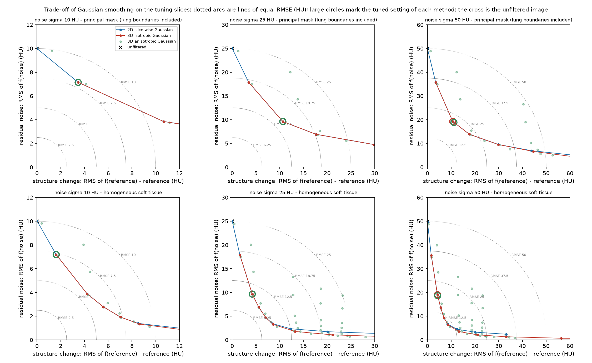

# Benchmark 3D: slice-wise versus volumetric Gaussian smoothing (full description)

This is the complete write-up of the two recorded runs `backend/docs/results/benchmark_3d_2026-10-26` (noise independent between slices) and `backend/docs/results/benchmark_3d_correlated_2026-10-27` (noise correlated between adjacent slices). The repository README gives the summary. Code: `backend/benchmark_3d.py` and its companion `backend/benchmark_3d_correlated.py`; tests: `backend/test_benchmark_3d.py`, `backend/test_benchmark_3d_correlated.py`, `backend/test_api_3d.py`.

> **Status: exploratory study.** One patient, eight held-out slices, a noisy clinical reference, synthetic noise, Gaussian smoothing only. It does not show that volumetric smoothing is better or worse in general, and it has no clinical meaning.

## Question and workflow

With 3 mm slices, is it worth smoothing across neighbouring slices? Three Gaussian families, each with its width given in **millimetres** and converted to voxels with the real voxel spacing (0.54 × 0.54 × 3.0 mm):

- *2D slice-wise*: in-plane only.
- *3D isotropic*: the same sigma in millimetres along x, y and z.
- *3D anisotropic*: in-plane and across-slice sigma tuned together; it contains the 2D family as the case sigma_z = 0, so on the tuning slices it can never score worse than 2D.

Workflow: convert the series to Hounsfield units; fix the evaluation masks from the original slices; add white noise of 10, 25 and 50 HU to the whole volume, independently for every voxel; for each noise level and family choose one setting on 3 tuning slices (35, 54, 74; two noise realisations each; RMSE_HU on the principal mask only); apply the frozen setting to 8 held-out slices (16, 21, 25, 45, 64, 84, 88, 93; five realisations each; every test slice at least 8 slices from every tuning slice); report means with percentile bootstrap intervals over slices (seed 12345, 10,000 resamples). The field-of-view padding (−2048 HU) is excluded from the smoothing by a normalised convolution, so it cannot leak into the body edge.

Besides RMSE_HU, PSNR and SSIM, every result is split into two parts that add up exactly. For a linear filter `f`, `f(reference + noise) − reference = [f(reference) − reference] + f(noise)`, so the squared error is the squared **structure change** (what the filter does to the reference with no noise present) plus the squared **residual noise** (what it leaves of the noise) plus a cross term that is reported. A *soft-tissue* region (0 to 100 HU, away from edges) shows what a filter can do where there is almost nothing to lose; the principal mask includes the lung boundaries and vessels and shows what it costs. The structure change also contains the removal of the reference's own noise, so it is not a pure loss of anatomy.

## Run 1: noise independent between voxels

Held-out results (8 slices, mean [95 % bootstrap interval over slices]; HU), principal mask unless stated:

| Noise | Method | Selected setting (sigma in plane / across slices, mm) | RMSE_HU | Structure change | Residual noise | RMSE_HU, soft tissue | SSIM (Wang) |
| --- | --- | --- | --- | --- | --- | --- | --- |
| white 10 HU | Noisy (no filter) | none | 10.00 [10.00, 10.01] | 0.00 | 10.00 | 10.00 [9.98, 10.01] | 0.9731 |
|  | 2D slice-wise Gaussian | 0.25 / 0 | 7.88 [7.80, 7.95] | 3.29 | 7.15 | 7.39 [7.34, 7.45] | 0.9850 |
|  | 3D isotropic Gaussian | 0.25 / 0.25 | 7.88 [7.80, 7.95] | 3.29 | 7.15 | 7.39 [7.34, 7.45] | 0.9850 |
|  | 3D anisotropic Gaussian | 0.25 / 0 | 7.88 [7.80, 7.95] | 3.29 | 7.15 | 7.39 [7.34, 7.45] | 0.9850 |
| white 25 HU | Noisy (no filter) | none | 24.98 [24.97, 25.00] | 0.00 | 24.98 | 24.97 [24.92, 25.02] | 0.8598 |
|  | 2D slice-wise Gaussian | 0.4 / 0 | 13.80 [13.36, 14.23] | 9.89 | 9.61 | 10.86 [10.65, 11.11] | 0.9687 |
|  | 3D isotropic Gaussian | 0.4 / 0.4 | 13.80 [13.36, 14.23] | 9.89 | 9.61 | 10.86 [10.65, 11.11] | 0.9687 |
|  | 3D anisotropic Gaussian | 0.4 / 0 | 13.80 [13.36, 14.23] | 9.89 | 9.61 | 10.86 [10.65, 11.11] | 0.9687 |
| white 50 HU | Noisy (no filter) | none | 49.99 [49.97, 50.01] | 0.00 | 49.99 | 50.01 [49.93, 50.08] | 0.6386 |
|  | 2D slice-wise Gaussian | 0.4 / 0 | 21.65 [21.37, 21.93] | 9.89 | 19.24 | 19.92 [19.77, 20.08] | 0.9120 |
|  | 3D isotropic Gaussian | 0.4 / 0.4 | 21.65 [21.37, 21.93] | 9.89 | 19.24 | 19.92 [19.77, 20.08] | 0.9120 |
|  | 3D anisotropic Gaussian | 0.4 / 1 | 21.55 [21.21, 21.86] | 10.43 | 18.82 | 19.54 [19.40, 19.70] | 0.9145 |



*Each point is one filter setting on the tuning slices: the horizontal axis is the structure change, the vertical axis the noise that is left; dotted arcs join points of equal RMSE; large circles are the settings selected for each method. Top row: principal mask. Bottom row: homogeneous soft tissue.*

What this shows, and what it does not:

- **Weak smoothing minimises the error.** The settings chosen on the tuning slices are in-plane sigmas of 0.25 mm (10 HU) and 0.4 mm (25 and 50 HU), that is 0.5 to 0.7 pixel. They bring the held-out RMSE_HU from 10, 25 and 50 HU down to 7.9, 13.8 and 21.7 HU. Wider kernels remove more noise but change the structure by more than they gain.
- **Smoothing across slices is not worth it on 3 mm slices.** At 10 and 25 HU the tuned 2D, 3D isotropic and 3D anisotropic filters give identical results: nothing is taken from neighbouring slices (the isotropic family selects 0.25 or 0.4 mm, about a tenth of a slice, which puts a weight below 1e-9 on a neighbour). At 50 HU the anisotropic family selects a very light kernel (sigma_z = 1 mm, about 1 % of the weight on each neighbouring slice) and lowers the held-out RMSE_HU by 0.11 HU [95 % interval −0.18, −0.04] out of 21.7, i.e. 0.5 %. RMSE_HU is lower in 6 of the 8 slices and slightly higher in 2; per noise realisation it is lower in 30 of 40 and higher in 10, with a mean of −0.11 HU and a standard deviation of 0.10 HU (from `test_per_slice.csv` and `test_per_run.csv`). This is a small, dataset-specific observation, not evidence that volumetric smoothing is better in general.
- **Why.** At an in-plane sigma of 0.4 mm and 25 HU noise, widening the kernel across one whole slice (sigma_z = 3 mm) cuts the residual noise from 9.6 to 5.1 HU, but raises the structure change on the principal mask from 10.7 to 43.5 HU, and even in the soft-tissue region from 4.2 to 13.2 HU (tuning slices): the anatomy changes between neighbouring 3 mm slices, soft tissue included.

## Run 2: noise correlated between adjacent slices

Run 1 is generous to smoothing across slices, because the added noise is independent between slices, whereas the real noise of this series is partly correlated between neighbouring slices. Measured on the series with `python diagnostics.py noise-texture` (a rough estimator on the high-pass residual, not a noise power spectrum): the residuals of adjacent slices correlate at +0.29 (mean over 62 slice pairs, +0.21 to +0.40), against +0.02 two slices apart and about 0 for simulated independent noise.

Run 2 repeats the protocol with the same grids, slices and seed bases, and replaces the noise by `n[k] = (e[k] + c · e[k+1]) / sqrt(1 + c²)` with independent white `e`; the correlation with the next slice is `c / (1 + c²)`, set to **0.3** (`c = 0.3333`), and is 0 beyond. Every slice is still white noise of the stated standard deviation. It is a model of one measured property of the series, not of a scanner. The companion script patches the noise generator of `benchmark_3d.py` for the duration of the run and restores it; `benchmark_3d.py` is unchanged, and the source hashes recorded in the run show that the same file produced run 1 (`9596439c5f…`).

Held-out principal-mask RMSE_HU (HU):

| Noise | Unfiltered | 2D slice-wise | 3D isotropic | 3D anisotropic | Selected sigma_z (anisotropic) |
| --- | --- | --- | --- | --- | --- |
| 10 HU | 10.00 | 7.87 | 7.87 | 7.87 | 0 mm |
| 25 HU | 24.99 | 13.80 | 13.80 | 13.80 | 0 mm |
| 50 HU | 50.00 | 21.66 | 21.66 | 21.66 | 0 mm |

With correlated noise the anisotropic family selects sigma_z = 0 at **every** level, so it equals the 2D filter exactly, and the paired difference to 2D is 0.0 in all conditions. The 0.11 HU gain at 50 HU in run 1 disappears. The likely reason is that averaging noise that is correlated between slices removes less of it while the loss of structure is unchanged (a test shows the expected reduction of the residual noise in the construction, but this explanation was not checked separately on the real series). On this series with this noise model there is nothing to gain from the third dimension. The condition names keep the prefix `white_` because they describe the structure inside a slice; the cross-slice correlation is recorded in `run_metadata.json` (`parameters.noise_model`) and shown by the dashboard.

## Limits of the evidence

- **One CT series, 3 tuning and 8 test slices of one patient.** Slices of one scan are not independent samples; no generalisation across patients, scanners, doses, kernels or slice thicknesses is claimed. In run 1 the closest test slice is 9 slices from a tuning slice; because a kernel can reach 8 slices, the neighbourhoods of a tuning and a test slice can overlap, so the two sets are different slices, not different anatomy.
- **Noisy clinical reference and synthetic noise.** Every score measures similarity to a noisy reference, not accuracy against the true anatomy. The two noise models are scenarios; neither is a validated model of real CT noise.
- **Only Gaussian smoothing is compared.** 3D median, bilateral, non-local means and other volumetric filters are not tested, and neither are thinner slices or resampling to isotropic voxels.
- **Bootstrap intervals** use 8 slices; a simulation gives 78 to 89 % coverage for a nominal 95 % (`python diagnostics.py bootstrap-coverage`), so read them as descriptive spread over slices.
- **No small-structure, edge or task-based measure.** A lower RMSE_HU does not show better preservation of anatomy or any clinical benefit.

## Provenance and reproduction

| | Run 1 (independent noise) | Run 2 (correlated noise) |
| --- | --- | --- |
| Directory | `benchmark_3d_2026-10-26` | `benchmark_3d_correlated_2026-10-27` |
| Generated | 2026-10-26 11:28 UTC | 2026-10-27 09:42 UTC |
| Commit recorded | `103d359…+dirty` | `ffc184a…+dirty` |
| Script | `benchmark_3d.py` | `benchmark_3d_correlated.py` (calls `benchmark_3d.py`) |
| Duration | about 8 minutes | about 8 minutes |

Both runs were made from an uncommitted working tree, so the recorded commit carries `+dirty`; the SHA-256 of every source file used (`benchmark_3d.py`, `benchmark_v2.py`, `requirements.txt`, `src/dicom_volume.py`, plus the companion script in run 2), of the input files and of every output is recorded in `run_metadata.json`, and the committed files can be compared with them. The API and the dashboard verify the result files against the recorded hashes. Two complete executions of run 1 gave identical tables, and 72 recorded rows were recomputed independently.

```bash
cd backend
python benchmark_3d.py --dicom-series "path/to/LIDC-IDRI-0709/<series folder>" --out "path/outside/repo/benchmark_3d_run" --plan-only
python benchmark_3d.py --dicom-series "path/to/LIDC-IDRI-0709/<series folder>" --out "path/outside/repo/benchmark_3d_run"
python benchmark_3d_correlated.py --dicom-series "path/to/LIDC-IDRI-0709/<series folder>" --out "path/outside/repo/benchmark_3d_correlated_run" --correlation 0.3
```

Prerequisites not provided by this repository: a local copy of the series (from TCIA, under its terms), the packages of `requirements.txt` (matplotlib for the figures) and an output directory **outside** the repository (the scripts refuse to write inside it unless `--allow-inside-repo` is given, which is meant for tests). Reproduction needs the series, but the tests do not: `test_benchmark_3d.py` checks the protocol on two synthetic volumes whose right answer is known (one where smoothing across slices must help and one where it must hurt), and `test_benchmark_3d_correlated.py` checks the noise construction (marginal variance, correlation with the next slice and zero beyond), that the original generator is restored, and that the shipped run's files match their recorded hashes.

## Dashboard (Benchmark 3D page)

The page shows the run's provenance and file integrity, held-out results per metric and region with intervals, the trade-off between structure change and residual noise, the paired difference of the anisotropic family to the slice-wise one, the selected parameters, statements computed from the tables, the recorded figures, the command that reproduces the run, and a side-by-side view of the two runs. Nothing is displayed unless the API serves a real run (`BENCHMARK_3D_RUN_DIRS`); the server never accepts paths from the browser.
